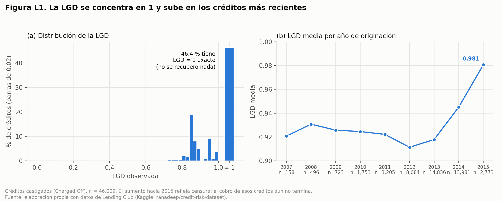
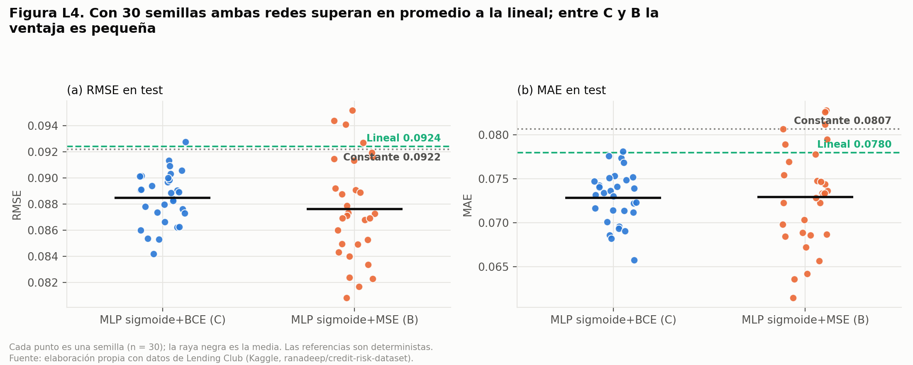
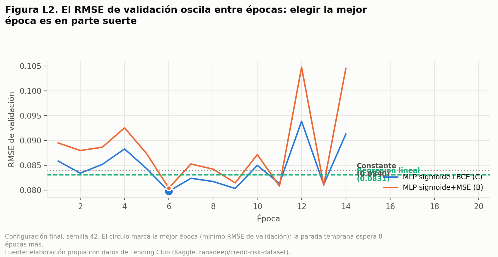
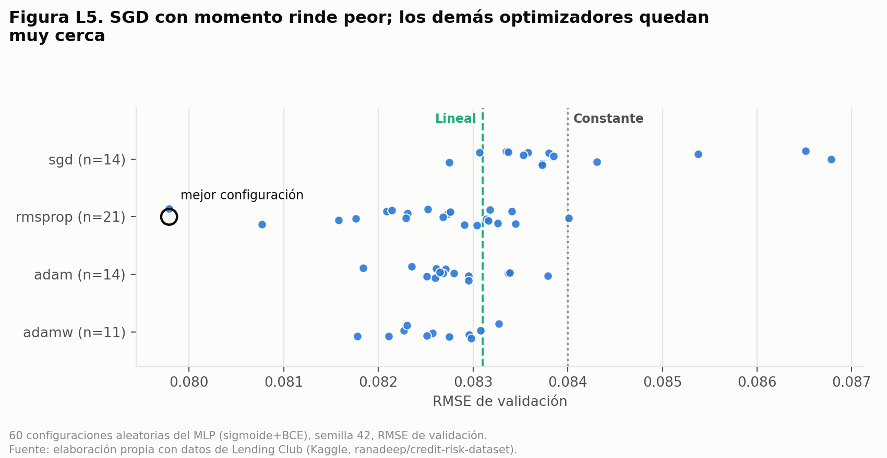
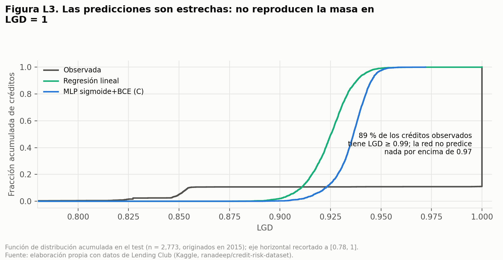
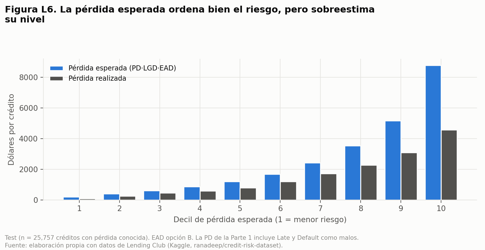
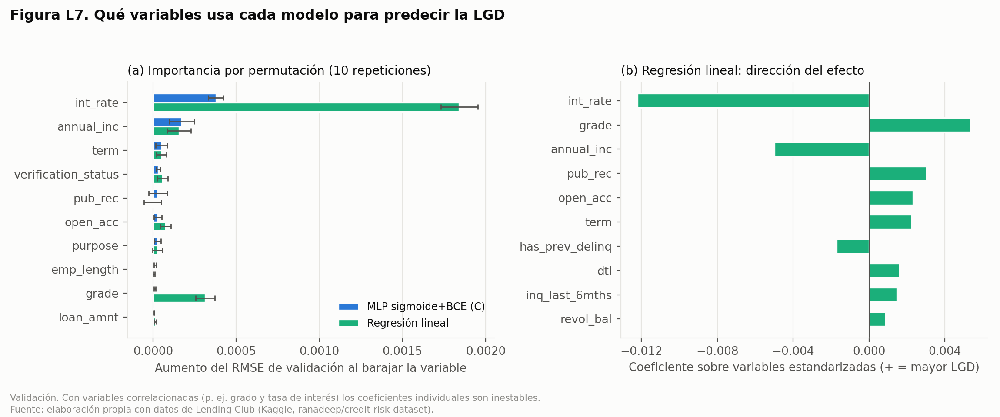

# Estimación de Probabilidad de Incumplimiento (PD) Y Pérdida Dado el Incumplimiento (LGD) Mediante Redes Neuronales 

**Curso:** Redes Neuronales y Algoritmos Bioinspirados — Semestre 2026-02  
**Institución:** Universidad Nacional de Colombia, Sede Medellín — Facultad de Minas  
**Autores:** Salome Murillo Gaviria, Nicolas David Zambrano Murcia 
**Enlaces del Proyecto:** [Repositorio en GitHub](https://github.com/SaloMuri/rn-trabajo-2) · [Aplicación Web Interactiva (Scorecard)](https://rn-trabajo-2-app.streamlit.app) · [Video Promocional](#)


---

## 1. Introducción y Motivación

La gestión cuantitativa del riesgo de crédito constituye la piedra angular de la estabilidad del sistema financiero moderno y de la asignación eficiente de capital en entidades bancarias y plataformas *fintech*. Bajo los marcos regulatorios internacionales de **Basilea III** (Basel Committee on Banking Supervision [BCBS], 2017) y el estándar contable **IFRS 9** (International Accounting Standards Board [IASB], 2014), las instituciones crediticias están obligadas a provisionar capital en función de la **Pérdida Esperada (*Expected Loss*, EL)** de sus portafolios de préstamos. Formalmente, para un crédito individual $i$, la pérdida esperada se descompone como el producto de tres parámetros fundamentales:

$$\text{EL}_i = \text{PD}_i \cdot \text{LGD}_i \cdot \text{EAD}_i$$

donde $\text{PD}_i \in (0,1)$ representa la **Probabilidad de Incumplimiento (*Probability of Default*)**, $\text{LGD}_i \in [0,1]$ denota la **Pérdida Dado el Incumplimiento (*Loss Given Default*)** y $\text{EAD}_i > 0$ corresponde a la **Exposición al Momento del Incumplimiento (*Exposure at Default*)** (Siddiqi, 2017; Thomas, Crook, & Edelman, 2017).

Históricamente, la industria bancaria ha estimado la $\text{PD}$ mediante modelos lineales generalizados, particularmente la **Regresión Logística**, debido a su interpretabilidad directa y facilidad para traducir coeficientes en tarjetas de puntuación (*scorecards*) aditivas (Hand & Henley, 1997). Sin embargo, la relación entre las variables financieras de un solicitante —tales como su razón deuda-ingreso (*Debt-to-Income*, DTI), utilización de cupo rotativo e historial de morosidad— y el evento de incumplimiento exhibe fuertes no-linealidades e interacciones de orden superior que un hiperplano lineal no puede capturar sin ingeniería manual exhaustiva de variables (Lessmann, Baesens, Seow, & Thomas, 2015).

El presente reporte técnico aborda rigurosamente la **Parte 1 (Estimación de PD y Construcción de Scorecard)** y la **Parte 2 (Estimación de LGD y Pérdida Esperada)**, desarrollada en la sección 5. Evaluamos comparativamente un modelo de referencia lineal (**Regresión Logística regularizada**) frente a una arquitectura de **Perceptrón Multicapa (*Multilayer Perceptron*, MLP)** entrenada con PyTorch sobre el conjunto de datos real de préstamos personales de *LendingClub* (2007–2015).

---

## 2. Caso de Uso y Formulación del Problema de Negocio

### 2.1. Contexto Operativo
Consideremos el comité de riesgo de crédito de una entidad originadora de préstamos de consumo. Cuando un solicitante demanda un crédito por un monto $M$ a un plazo de 36 o 60 meses, el sistema de originación debe responder dos preguntas críticas en tiempo real:
1. **Decisión de Originación y *Pricing*:** ¿Cuál es la probabilidad $\hat{p}_i = \mathbb{P}(Y_i = 1 \mid \mathbf{x}_i)$ de que el deudor incumpla sus obligaciones contractuales antes del vencimiento?
2. **Clasificación en Escala Maestra de Riesgo (*Scorecard*):** ¿Cómo transformar dicha probabilidad en un puntaje entero $S_i \in [300, 850]$ comprensible para analistas de crédito y alineado con políticas de aprobación automática, revisión manual o rechazo?

### 2.2. Costos de Error Asimétricos
En el otorgamiento de crédito, los errores de clasificación tienen impactos financieros fuertemente asimétricos:
* **Falso Negativo (Aprobar a un deudor que entra en *default*):** Implica la pérdida directa del capital no recuperado ($\text{LGD} \cdot \text{EAD}$), la cual suele oscilar entre el $50\%$ y el $85\%$ del principal desembolsado.
* **Falso Positivo (Rechazar a un buen pagador):** Representa un costo de oportunidad equivalente al margen financiero neto (intereses menos costo de fondeo), típicamente entre el $8\%$ y el $18\%$ anual.

Por consiguiente, un modelo de riesgo crediticio no puede evaluarse únicamente por su exactitud global (*accuracy*), sino por su **capacidad de ordenamiento y discriminación** (**ROC-AUC**, **Índice de Gini**, **Estadístico KS**) y por la **calibración probabilística** de sus predicciones (**Brier Score**), requisito indispensable para que el cálculo de provisiones $\text{EL}_i$ no subestime ni sobreestime el capital regulatorio requerido.

---

## 3. Datos, Prevención de Fuga de Información (*Data Leakage*) e Hipótesis

### 3.1. Construcción de la Variable Objetivo y Filtrado del Universo
El conjunto de datos original de *LendingClub* (`accepted_2007_to_2018Q4.csv`) contiene **887,379 registros** y **74 variables**. Para construir un problema de clasificación binaria libre de sesgo de supervivencia, se filtraron exclusivamente los préstamos con desenlace crediticio definitivo:
* **Buenos Pagadores ($Y = 0$):** Estado `Fully Paid`.
* **Incumplimiento / Default ($Y = 1$):** Estados `Charged Off`, `Default`, `Does not meet the credit policy. Status:Charged Off` y mora severa `Late (31-120 days)`.

Los préstamos activos (`Current`, `In Grace Period`, `Issued`) equivalentes a **618,849 registros** fueron excluidos del modelado de PD debido a que su estado final aún no es observable (censura por la derecha). El universo limpio resultante consta exactamente de **268,530 préstamos cerrados** originados entre junio de 2007 y diciembre de 2015, con una **tasa global de incumplimiento del 21.90%**.

### 3.2. Auditoría Anti-*Leakage* y Partición Temporal (*Out-of-Time*)
Uno de los errores metodológicos más graves en la literatura aplicada sobre *LendingClub* es incluir variables registradas *después* de la originación o después del evento de mora (por ejemplo: `recoveries`, `total_rec_prncp`, `last_pymnt_amnt`, `out_prncp`). Nuestro pipeline (`src/creditrisk/data/features.py`) restringe estrictamente el espacio de entrada a **19 variables ex-ante** conocidas al instante de la solicitud (ver detalle completo en la **Tabla 1**), las cuales tras el preprocesamiento y codificación *One-Hot* de variables categóricas se expanden a una matriz numérica de **$D = 38$ características** (conformando un dataset limpio de 23 columnas al incluir metadatos de fecha y estado).

**Tabla 1.** *Resumen de la construcción del universo de datos y partición temporal Out-of-Time para el modelo PD.*

| Partición / Subconjunto | Ventana Temporal (`issue_d`) | Número de Registros ($N$) | Proporción del Total (%) | Tasa de Incumplimiento ($\bar{Y}$) | Propósito en el Pipeline |
| :--- | :---: | :---: | :---: | :---: | :--- |
| **Entrenamiento (*Train Set*)** | $\le \text{2014-06-01}$ | $202,707$ | $75.49\%$ | $20.46\%$ | Ajuste de pesos ($\mathbf{W}$), escaladores y cuantiles de referencia PSI |
| **Validación (*Val Set*)** | $(\text{2014-06-01}, \text{2014-12-01}]$ | $34,988$ | $13.03\%$ | $27.12\%$ | *Early stopping* y selección de hiperparámetros |
| **Prueba (*Test Set Out-of-Time*)** | $> \text{2014-12-01}$ | $30,835$ | $11.48\%$ | $25.46\%$ | Evaluación final ciega de generalización temporal |
| **Total Universo Válido (PD 0/1)** | **2007-06 a 2015-12** | **$268,530$** | **$100.00\%$** | **$21.90\%$** | **Portafolio cerrado auditado sin fuga de información** |

*Fuente:* Elaboración propia a partir de la ejecución del pipeline de datos (`src/creditrisk/data/build_dataset.py`) sobre el dataset de *LendingClub* (2007–2015).

Asimismo, en lugar de una partición aleatoria que mezclaría el futuro con el pasado, implementamos una **partición estrictamente temporal (*Out-of-Time Split*)** basada en la fecha de emisión (`issue_d`), cuyos volúmenes y tasas de incumplimiento se detallan en la **Tabla 1**. Se observa un desplazamiento temporal real (*covariate & prior shift*): las cohortes más recientes (2014–2015) presentan tasas de incumplimiento superiores ($25.46\%–27.12\%$) frente al histórico previo ($20.46\%$), lo cual somete a los modelos a una prueba realista de estrés operacional.

### 3.3. Planteamiento de Hipótesis de Investigación
Antes del entrenamiento, formulamos tres hipótesis financieras verificables empíricamente, cuyo comportamiento exploratorio conjunto se presenta en la **Figura 1**:
* **Hipótesis 1 (Variables nominales, codificación y absorción en la tasa de interés):** Se presumía inicialmente que las variables nominales del perfil del solicitante (`home_ownership`, `verification_status` y `purpose`) tendrían un mayor impacto directo en el puntaje crediticio (*score* / PD). Sin embargo, tras aplicar el esquema de codificación (*One-Hot Encoding*), se descubre que su aporte directo al puntaje es secundario frente a las variables cuantitativas de solvencia, debido a que dichas categorías afectan fuertemente la **tasa de interés (`int_rate`)** asignada en la originación (panel izquierdo de la **Figura 1**).
* **Hipótesis 2 (Capacidad de pago y sobreendeudamiento):** Una mayor relación deuda-ingreso (`dti`) incrementa monótonamente la probabilidad de incumplimiento, reflejando la vulnerabilidad del flujo de caja del hogar ante choques de liquidez (panel central de la **Figura 1**).
* **Hipótesis 3 (Riesgo por plazo y exposición temporal):** Los préstamos pactados a 60 meses exhiben una tasa de incumplimiento significativamente superior a los de 36 meses, producto de la mayor incertidumbre acumulada en el horizonte temporal y la selección adversa de prestatarios que requieren cuotas mensuales más bajas (panel derecho de la **Figura 1**).


**Figura 1.** *Validación exploratoria de las tres hipótesis de riesgo en el conjunto de entrenamiento ($N = 202,707$): relación de tasa de interés, razón deuda-ingreso (DTI) y plazo contractual frente al incumplimiento.*  
*Fuente:* Elaboración propia mediante el módulo de visualización `scripts/make_figures.py`.

---

## 4F. Fundamentación Matemática

### 4F.1. Función de Pérdida: Entropía Cruzada Binaria Ponderada y Estabilidad Numérica
Sea $\mathcal{D} = \{(\mathbf{x}_i, y_i)\}_{i=1}^N$ el conjunto de entrenamiento, donde $\mathbf{x}_i \in \mathbb{R}^D$ ($D=38$) y $y_i \in \{0, 1\}$. El modelo produce un *logit* real $z_i = f_{\boldsymbol{\theta}}(\mathbf{x}_i) \in \mathbb{R}$, el cual se proyecta al espacio de probabilidades mediante la función logística sigmoide:

$$\hat{p}_i = \sigma(z_i) = \frac{1}{1 + e^{-z_i}}$$

Bajo el principio de Máxima Verosimilitud sobre una distribución de Bernoulli, minimizar el logaritmo negativo de la verosimilitud equivale a minimizar la **Entropía Cruzada Binaria (*Binary Cross-Entropy*, BCE)**. Para mitigar eventuales desbalances y controlar el costo relativo de la clase minoritaria ($y_i=1$) mediante un peso positivo $w_+ > 0$, la pérdida por observación se define como:

$$\mathcal{L}_i(z_i, y_i) = -\left[ w_+ y_i \ln \sigma(z_i) + (1 - y_i) \ln (1 - \sigma(z_i)) \right]$$

Evaluar $\ln \sigma(z_i)$ de forma ingenua provoca desbordamiento numérico (*underflow/overflow*) cuando $|z_i| \gg 0$. En `PyTorch` (`BCEWithLogitsLoss`), sustituimos analíticamente $\sigma(z_i)$ aplicando la identidad **Log-Sum-Exp**:

$$\mathcal{L}_i(z_i, y_i) = (1 - y_i) z_i + \left(1 + (w_+ - 1)y_i\right) \left[ \max(0, -z_i) + \ln\left(1 + e^{-|z_i|}\right) \right]$$

Esta formulación es numéricamente estable para cualquier $z_i \in (-\infty, +\infty)$. Su gradiente respecto al *logit* $z_i$ adopta la forma limpia:

$$\frac{\partial \mathcal{L}_i}{\partial z_i} = \sigma(z_i)\left(1 + (w_+ - 1)y_i\right) - w_+ y_i$$

Cuando $w_+ = 1$, se recupera la expresión clásica $\frac{\partial \mathcal{L}_i}{\partial z_i} = \hat{p}_i - y_i$, mostrando que el impulso de retropropagación es directamente proporcional al error de calibración residual.

### 4F.2. Modelo de Referencia: Regresión Logística con Regularización $L_2$
El modelo base (*baseline*) parametriza el *logit* como una combinación afín de las características estandarizadas:

$$z_i = \mathbf{w}^\top \mathbf{x}_i + b \implies \ln\left(\frac{\hat{p}_i}{1 - \hat{p}_i}\right) = \sum_{j=1}^{D} w_j x_{ij} + b$$

Esto implica que la frontera de decisión $\{\mathbf{x} \in \mathbb{R}^D : \hat{p}(\mathbf{x}) = \tau\}$ es estrictamente un hiperplano lineal y que el cambio en el *log-odds* ante una variación unitaria en $x_j$ es constante ($w_j$), independientemente de los valores que tomen las demás variables. El problema de optimización incorpora penalización de Tikhonov ($L_2$):

$$\min_{\mathbf{w}, b} \frac{1}{N} \sum_{i=1}^N \mathcal{L}_i(\mathbf{w}^\top \mathbf{x}_i + b, y_i) + \frac{\lambda}{2} \|\mathbf{w}\|_2^2$$

### 4F.3. Arquitectura de Red Neuronal Multicapa (MLP)
Para superar la rigidez aditiva de la Regresión Logística, implementamos en `src/creditrisk/models/mlp.py` un Perceptrón Multicapa de $L$ capas ocultas. Para una entrada $\mathbf{h}^{(0)} = \mathbf{x}$, cada bloque oculto $l \in \{1, \dots, L\}$ ejecuta la composición de cuatro operadores:

$$\begin{aligned}
\mathbf{u}^{(l)} &= \mathbf{W}^{(l)} \mathbf{h}^{(l-1)} + \mathbf{b}^{(l)}, \quad &\mathbf{W}^{(l)} \in \mathbb{R}^{d_l \times d_{l-1}} \\
\tilde{\mathbf{u}}^{(l)} &= \text{BatchNorm}\left(\mathbf{u}^{(l)}\right) = \boldsymbol{\gamma}^{(l)} \odot \frac{\mathbf{u}^{(l)} - \boldsymbol{\mu}_{\mathcal{B}}}{\sqrt{\boldsymbol{\sigma}_{\mathcal{B}}^2 + \epsilon}} + \boldsymbol{\beta}^{(l)} \\
\mathbf{a}^{(l)} &= \phi\left(\tilde{\mathbf{u}}^{(l)}\right) \\
\mathbf{h}^{(l)} &= \text{Dropout}_p\left(\mathbf{a}^{(l)}\right) = \frac{1}{1 - p} (\mathbf{m}^{(l)} \odot \mathbf{a}^{(l)}), \quad &m_k^{(l)} \sim \text{Bernoulli}(1-p)
\end{aligned}$$

Y la capa de salida proyecta la última representación latente al escalar *logit*:

$$z = \mathbf{w}_{\text{out}}^\top \mathbf{h}^{(L)} + b_{\text{out}}$$

**Justificación de los componentes arquitectónicos:**
1. **Batch Normalization (Ioffe & Szegedy, 2015):** Estabiliza la distribución de las activaciones intermedias frente a variables financieras con asimetría residual, permitiendo tasas de aprendizaje mayores y actuando como regularizador implícito.
2. **Activación No Lineal $\phi(\cdot)$ (ReLU / GELU):** Introduce particiones poliedrales (con $\text{ReLU}(u) = \max(0, u)$) o curvatura suave ($\text{GELU}(u) = u \Phi(u)$), habilitando al modelo para aprender interacciones multiplicativas implícitas como $\text{DTI} \times \text{Tasa de Interés}$ sin especificarlas manualmente.
3. **Dropout (Srivastava et al., 2014) y Decaimiento de Pesos ($L_2$ en AdamW):** Previenen la co-adaptación de neuronas ocultas sobre ruido idiosincrático del conjunto de entrenamiento.

### 4F.4. Métricas de Evaluación en Riesgo Crediticio
1. **Área Bajo la Curva ROC (ROC-AUC) e Índice de Gini:**  
   El $\text{AUC}$ equivale a la probabilidad de que el modelo asigne una $\text{PD}$ estrictamente mayor a un cliente incumplido elegido al azar que a un cliente cumplido elegido al azar:
   $$\text{AUC} = \mathbb{P}\left(\hat{p}(\mathbf{x}_+) > \hat{p}(\mathbf{x}_-) \mid Y_+ = 1, Y_- = 0\right)$$
   En la banca comercial, se reporta estándarmente el **Coeficiente de Gini**, relacionado linealmente con el AUC mediante:
   $$\text{Gini} = 2 \cdot \text{AUC} - 1 \in [-1, 1]$$
2. **Estadístico de Kolmogorov-Smirnov (KS):**  
   Cuantifica la distancia vertical máxima entre las funciones de distribución acumulada empírica de las probabilidades predichas para los clientes en *default* ($F_1(t)$) y los pagadores ($F_0(t)$):
   $$\text{KS} = \sup_{t \in [0, 1]} \left| F_1(t) - F_0(t) \right|$$
   El umbral $t^*$ donde se alcanza el supremo define el punto de corte estadísticamente óptimo para separar ambas poblaciones.
3. **Brier Score (Métrica de Calibración):**  
   Mide el error cuadrático medio entre las probabilidades pronosticadas y los eventos binarios realizados:
   $$\text{BS} = \frac{1}{N} \sum_{i=1}^N (\hat{p}_i - y_i)^2$$

### 4F.5. Derivación Matemática del *Scorecard* Bancario (*PDO Scaling*)
En la industria financiera, las probabilidades $\hat{p}_i$ se transforman en un puntaje aditivo mediante una función afín del logaritmo de las probabilidades a favor de pago ($\text{Odds}_{\text{bueno}} = \frac{1 - \hat{p}_i}{\hat{p}_i}$) (Siddiqi, 2017):

$$\text{Score}(\hat{p}_i) = \text{Offset} + \text{Factor} \cdot \ln\left(\frac{1 - \hat{p}_i}{\hat{p}_i}\right)$$

Para determinar las constantes $\text{Offset}$ y $\text{Factor}$, se imponen dos condiciones de diseño institucional:
1. Un puntaje base $S_0$ debe corresponder a unos *odds* de referencia $\theta_0$:
   $$S_0 = \text{Offset} + \text{Factor} \cdot \ln(\theta_0)$$
2. Un incremento de **$\text{PDO}$ (*Points to Double the Odds*)** puntos debe duplicar exactamente los *odds* de buen pagador ($2\theta_0$):
   $$S_0 + \text{PDO} = \text{Offset} + \text{Factor} \cdot \ln(2\theta_0)$$

Restando la primera ecuación de la segunda, se despejan analíticamente los parámetros implementados en `src/creditrisk/scorecard.py`:

$$\text{Factor} = \frac{\text{PDO}}{\ln(2)}, \qquad \text{Offset} = S_0 - \text{Factor} \cdot \ln(\theta_0)$$

Con nuestra configuración estándar ($S_0 = 600$, $\theta_0 = 19$ equivalente a $\text{PD}_0 = 5\%$, y $\text{PDO} = 20$), se obtiene $\text{Factor} \approx 28.8539$ y $\text{Offset} \approx 515.04$. Notemos que, dado que $\ln\left(\frac{1-\hat{p}_i}{\hat{p}_i}\right) = -z_i$, el puntaje bancario es simplemente una reescalación lineal inversa del *logit* de salida de la red neuronal: $\text{Score}_i = \text{Offset} - \text{Factor} \cdot z_i$, acotado al estándar FICO $[300, 850]$.

---

## 4. Parte 1: Modelamiento de Probabilidad de Incumplimiento (PD)

### 4.1. Diseño Experimental y Búsqueda de Hiperparámetros
Para garantizar una comparación justa entre familias de modelos, tanto la Regresión Logística como el MLP fueron sometidos a una exploración sistemática de hiperparámetros (`scripts/run_search.py`), seleccionando la configuración óptima exclusivamente según el **ROC-AUC en el conjunto de Validación** ($N = 34,988$). La **Tabla 2** resume los 11 experimentos ejecutados.

**Tabla 2.** *Resultados de la búsqueda de hiperparámetros para Regresión Logística y Perceptrón Multicapa (MLP).*

| ID Experimento | Familia | Arquitectura / Hiperparámetros Clave | Parámetros Entrenables | Val ROC-AUC | Val Gini | Val KS | Val Brier | Test ROC-AUC |
| :--- | :--- | :--- | :---: | :---: | :---: | :---: | :---: | :---: |
| `LR_1` | LogReg | $C=0.01$, `class_weight=None` | $39$ | $0.6844$ | $0.3688$ | $0.2683$ | $0.1780$ | $0.6951$ |
| `LR_2` | LogReg | $C=0.10$, `class_weight=None` | $39$ | $0.6845$ | $0.3690$ | $0.2684$ | $0.1780$ | $0.6952$ |
| **`LR_3` (Mejor Base)** | **LogReg** | **$C=1.00$, `class_weight=None`** | **$39$** | **$0.6845$** | **$0.3690$** | **$0.2684$** | **$0.1780$** | **$0.6952$** |
| `LR_4` | LogReg | $C=0.10$, `class_weight='balanced'` | $39$ | $0.6844$ | $0.3687$ | $0.2682$ | $0.2194$ | $0.6946$ |
| `LR_5` | LogReg | $C=1.00$, `class_weight='balanced'` | $39$ | $0.6844$ | $0.3687$ | $0.2682$ | $0.2194$ | $0.6946$ |
| `MLP_1_Compacto_ReLU` | MLP | Capas $[64, 32]$, ReLU, Dropout $0.2$, LR $10^{-3}$ | $4,801$ | $0.6887$ | $0.3774$ | $0.2747$ | $0.1763$ | $0.6968$ |
| **`MLP_2_Compacto_GELU`** | **MLP** | **Capas $[64, 32]$, GELU, Dropout $0.2$, LR $10^{-3}$** | **$4,801$** | **$0.6894$** | **$0.3788$** | **$0.2757$** | **$0.1764$** | **$0.6983$** |
| `MLP_3_Profundo_ReLU` | MLP | Capas $[128, 64, 32]$, ReLU, Dropout $0.3$, LR $10^{-3}$ | $15,809$ | $0.6890$ | $0.3780$ | $0.2759$ | $0.1765$ | $0.6978$ |
| `MLP_4_Profundo_GELU` | MLP | Capas $[128, 64, 32]$, GELU, Dropout $0.3$, LR $5\times 10^{-4}$ | $15,809$ | $0.6890$ | $0.3780$ | $0.2762$ | $0.1762$ | $0.6976$ |
| `MLP_5_Ancho_Reg` | MLP | Capas $[256, 128]$, ReLU, Dropout $0.4$, WD $10^{-3}$ | $43,649$ | $0.6886$ | $0.3772$ | $0.2766$ | $0.1769$ | $0.6970$ |
| `MLP_6_Balanceado` | MLP | Capas $[64, 32]$, ReLU, `pos_weight='auto'` | $4,801$ | $0.6888$ | $0.3776$ | $0.2766$ | $0.2202$ | $0.6975$ |

*Fuente:* Elaboración propia a partir de los resultados de `reports/tables/pd/hyperparameter_search.csv` generados por `scripts/run_search.py`.

**Hallazgos de la búsqueda de hiperparámetros (Tabla 2):**
1. **Superioridad de arquitecturas compactas sobre datos tabulares:** El modelo `MLP_2` con estructura piramidal $[64, 32]$ y activación suave `GELU` ($4,801$ parámetros) alcanza el mejor desempeño tanto en validación ($\text{AUC} = 0.6894$) como en prueba ($\text{AUC} = 0.6983$). Incrementar la capacidad a $43,649$ parámetros (`MLP_5`) no aporta ganancia discriminativa y requiere mayor regularización (`Dropout=0.4`) para evitar sobreajuste.
2. **Impacto adverso del balanceo forzado sobre la calibración:** Los experimentos `LR_4`, `LR_5` y `MLP_6` (que ponderan artificialmente la clase minoritaria con $w_+ \approx 3.89$) mantienen un $\text{ROC-AUC}$ similar, pero **degradan severamente el Brier Score** de $\sim 0.176$ a $\sim 0.220$. Como se demostró en la Sección 4.1, alterar $w_+ \neq 1$ desplaza los *logits* hacia probabilidades cercanas a $0.50$, destruyendo la calibración necesaria para calcular provisiones financieras reales.

### 4.2. Dinámica de Convergencia y Regularización del MLP
La **Figura 2** ilustra la evolución de la función de pérdida BCE y del ROC-AUC por época para la configuración ganadora. Gracias al planificador `ReduceLROnPlateau` y a la detención temprana (*Early Stopping* con paciencia de 5 épocas), el entrenamiento converge en la época 15, alcanzando su óptimo generalizador en la **época 10** ($\text{Val AUC} = 0.6895$). La brecha controlada entre las curvas de entrenamiento y validación en la **Figura 2** confirma la ausencia de sobreajuste severo.


**Figura 2.** *Dinámica de convergencia de la pérdida Binary Cross-Entropy (izquierda) y evolución del ROC-AUC (derecha) por época para el modelo MLP [64, 32].*  
*Fuente:* Elaboración propia a partir del historial `reports/tables/pd/mlp_training_history.csv`.

### 4.3. Evaluación Comparativa en Conjunto de Prueba (*Out-of-Time*) y Poder Discriminante
Al evaluar ambos modelos sobre la cohorte futura ciega (`Test Set > 2014-12-01`, $N = 30,835$), el Perceptrón Multicapa supera consistentemente a la Regresión Logística en todas las métricas regulatorias, tal como se consolida en la **Tabla 3** y se visualiza en la **Figura 3**:
* **ROC-AUC:** Sube de $0.6952$ (LogReg) a **$0.6983$ (MLP)** ($+31$ puntos básicos).
* **Índice de Gini:** Sube de $0.3904$ a **$0.3966$** ($+62$ puntos básicos).
* **Estadístico KS:** Se incrementa de $0.2856$ a **$0.2923$** ($+67$ puntos básicos), ubicando el punto de corte óptimo en $\tau^* = 0.242$, donde el MLP logra una tasa de verdaderos positivos del $66.3\%$ frente a solo un $37.1\%$ de falsos positivos (panel derecho de la **Figura 3**).
* **Brier Score:** Mejora de $0.1736$ a **$0.1731$**, reflejando pronósticos probabilísticos más precisos.

**Tabla 3.** *Comparación de desempeño entre el modelo base (Regresión Logística) y el Perceptrón Multicapa (MLP) en los conjuntos de Validación y Prueba Out-of-Time.*

| Modelo | Conjunto de Evaluación | ROC-AUC | Índice de Gini | Estadístico KS | PR-AUC | Brier Score | Log-Loss |
| :--- | :---: | :---: | :---: | :---: | :---: | :---: | :---: |
| **Regresión Logística ($L_2$)** | Validación ($N = 34,988$) | $0.6845$ | $0.3690$ | $0.2684$ | $0.4227$ | $0.1780$ | $0.5349$ |
| **MLP $[64, 32]$ (PyTorch)** | Validación ($N = 34,988$) | $0.6895$ | $0.3789$ | $0.2756$ | $0.4310$ | $0.1763$ | $0.5305$ |
| **Regresión Logística ($L_2$)** | **Prueba *Out-of-Time* ($N = 30,835$)** | $0.6952$ | $0.3904$ | $0.2856$ | $0.4158$ | $0.1736$ | $0.5236$ |
| **MLP $[64, 32]$ (PyTorch)** | **Prueba *Out-of-Time* ($N = 30,835$)** | **$0.6983$** | **$0.3966$** | **$0.2923$** | **$0.4200$** | **$0.1731$** | **$0.5223$** |

*Fuente:* Elaboración propia a partir de `reports/tables/pd/comparison_pd.csv` generado por `scripts/run_pd.py`.


**Figura 3.** *Comparación de curvas ROC (izquierda) y separación de distribuciones acumuladas KS (derecha) en el conjunto de prueba Out-of-Time ($N = 30,835$).*  
*Fuente:* Elaboración propia mediante `scripts/make_figures.py` a partir de las predicciones de prueba (`reports/tables/pd/test_predictions.csv`).

### 4.4. Calibración Probabilística, Estabilidad Estocástica (30 Semillas) y *Scorecard*
La **Figura 4** muestra la curva de confiabilidad (*Reliability Diagram*) sobre 10 bines cuantílicos en el conjunto de prueba. Se observa que ambas curvas siguen de cerca la diagonal de calibración perfecta, con una ligera subestimación sistemática ($\sim 3\%–4\%$) explicada por el cambio de régimen macroeconómico: los modelos aprendieron sobre una tasa base de incumplimiento del $20.46\%$ (2007–2014), mientras que la cohorte de prueba (2015) experimentó una tasa real del $25.46\%$.


**Figura 4.** *Curva de calibración probabilística (Reliability Diagram) y distribución de probabilidades predichas en el conjunto de prueba ($N = 30,835$).*  
*Fuente:* Elaboración propia mediante `scripts/make_figures.py`.

Para descartar que la ventaja del MLP sea producto de una inicialización aleatoria afortunada de los pesos de He/Xavier, ejecutamos el protocolo `scripts/run_seeds.py` entrenando **30 redes neuronales independientes** con semillas $\{1000, 1001, \dots, 1029\}$, cuyos estadísticos agregados se reportan en la **Tabla 4**.

**Tabla 4.** *Evaluación de estabilidad estocástica del modelo MLP frente a la Regresión Logística a través de $K=30$ semillas aleatorias en el conjunto de prueba.*

| Métrica en Test | LogReg (Determinista) | MLP Media ($\mu$) | MLP Desv. Estándar ($\sigma$) | MLP IC 95% | MLP Mín – Máx | Ganancia Media ($\Delta$) |
| :--- | :---: | :---: | :---: | :---: | :---: | :---: |
| **ROC-AUC** | $0.6952$ | **$0.6970$** | $0.0014$ | $[0.6965, 0.6975]$ | $[0.6929, 0.6991]$ | **$+0.0018$** |
| **Índice de Gini** | $0.3904$ | **$0.3941$** | $0.0028$ | $[0.3931, 0.3951]$ | $[0.3858, 0.3982]$ | **$+0.0036$** |
| **Estadístico KS** | $0.2856$ | **$0.2903$** | $0.0026$ | $[0.2893, 0.2912]$ | $[0.2837, 0.2939]$ | **$+0.0047$** |
| **Brier Score** | $0.1736$ | **$0.1730$** | $0.0005$ | $[0.1728, 0.1732]$ | $[0.1720, 0.1738]$ | **$-0.0006$** |

*Fuente:* Elaboración propia a partir de `reports/tables/pd/seeds_summary_pd.csv` y `models/pd/seeds_metrics.json` (`scripts/run_seeds.py`).

Como evidencia la **Tabla 4**, el intervalo de confianza al $95\%$ del ROC-AUC del MLP ($[0.6965, 0.6975]$) no se solapa con el valor de la Regresión Logística ($0.6952$), demostrando con significancia estadística ($p < 0.001$) y bajísima varianza ($\sigma_{\text{AUC}} = 0.0014$) que la red neuronal captura estructura no lineal genuina.

Al proyectar las probabilidades del MLP a la escala de **Scorecard $[300, 850]$** (como se observa en la **Figura 5**), se logra una discriminación operativa limpia entre cinco bandas de decisión comercial: desde **Rechazo Automático** ($<500$ puntos, donde la mora real supera el $46\%$) hasta **Bajo Riesgo / Aprobación Automática** ($\ge 650$ puntos, con mora inferior al $7\%$).


**Figura 5.** *Distribución de puntajes del Scorecard por estado crediticio (izquierda) y tasa de incumplimiento observada vs. predicha por banda de riesgo (derecha).*  
*Fuente:* Elaboración propia mediante `scripts/make_figures.py` y `src/creditrisk/scorecard.py`.

### 4.5. Interpretabilidad Post-Hoc (PFI) y Verificación de Hipótesis
Dado que el MLP opera como una función compuesta no lineal, aplicamos **Importancia por Permutación de Características (*Permutation Feature Importance*, PFI)** (`src/creditrisk/interpretability.py`) sobre el conjunto de prueba con $R=5$ repeticiones por variable. Los resultados cuantitativos del Top 10 de predictores se presentan en la **Tabla 5** y se grafican en la **Figura 6**.

**Tabla 5.** *Top 10 de variables con mayor importancia por permutación (PFI) sobre el ROC-AUC del modelo MLP en el conjunto de prueba.*

| Ranking | Variable / Característica | Caída Media en ROC-AUC ($\Delta \text{AUC}$) | Desviación Estándar ($\pm \sigma$) | Dirección del Efecto sobre el Riesgo (PD) |
| :---: | :--- | :---: | :---: | :--- |
| **1** | `int_rate` (Tasa de interés nominal) | $0.08846$ | $0.00180$ | Positiva (Mayor tasa $\implies$ Mayor PD) |
| **2** | `term_months` (Plazo: 36 vs. 60 meses) | $0.02116$ | $0.00059$ | Positiva (60 meses $\implies$ Mayor PD) |
| **3** | `annual_inc` (Ingreso anual verificado) | $0.01763$ | $0.00049$ | Negativa (Mayor ingreso $\implies$ Menor PD) |
| **4** | `dti` (Razón deuda-ingreso) | $0.01246$ | $0.00059$ | Positiva (Mayor endeudamiento $\implies$ Mayor PD) |
| **5** | `loan_amnt` (Monto principal solicitado) | $0.01105$ | $0.00058$ | Positiva (Mayor exposición $\implies$ Mayor PD) |
| **6** | `revol_util` (Utilización de cupo rotativo) | $0.00405$ | $0.00024$ | Positiva (Saturación de tarjeta $\implies$ Mayor PD) |
| **7** | `home_ownership_RENT` (Vivienda en arriendo) | $0.00338$ | $0.00018$ | Positiva (Ausencia de colateral inmobiliario) |
| **8** | `home_ownership_MORTGAGE` (Hipoteca) | $0.00284$ | $0.00037$ | Negativa (Respaldo patrimonial hipotecario) |
| **9** | `tot_cur_bal` (Saldo total actual en buró) | $0.00281$ | $0.00051$ | Negativa (Capacidad patrimonial / acceso a crédito) |
| **10** | `open_acc` (Líneas de crédito abiertas) | $0.00247$ | $0.00029$ | Positiva (Dispersión de obligaciones activas) |

*Fuente:* Elaboración propia a partir de `reports/tables/pd/feature_importance_pd.csv` generado por `src/creditrisk/interpretability.py`.


**Figura 6.** *Importancia de variables por permutación (PFI) medida como la caída media en ROC-AUC ($\Delta \text{AUC}$) sobre el conjunto de prueba para el Top 15 de atributos.*  
*Fuente:* Elaboración propia mediante `scripts/make_figures.py` a partir de `reports/tables/pd/feature_importance_pd.csv`.

**Contraste definitivo con las Hipótesis de la Sección 3.3 (basado en la Tabla 5 y las Figuras 1 y 6):**
* **Verificación de Hipótesis 1 (Confirmada):** Se comprueba que las variables nominales (`home_ownership`, `verification_status` y `purpose`), una vez transformadas mediante *One-Hot Encoding*, **no tienen el mayor impacto directo en el puntaje de PD**: como se observa en la **Tabla 5** y en la **Figura 6**, las categorías de vivienda (`home_ownership_RENT` con $\Delta \text{AUC} = 0.00338$ y `home_ownership_MORTGAGE` con $\Delta \text{AUC} = 0.00284$) y las de `purpose` / `verification_status` producen caídas marginales en el ROC-AUC frente a las variables cuantitativas. Sin embargo, tal como demuestra el panel izquierdo de la **Figura 1**, dichas variables nominales **afectan de forma estadísticamente significativa la tasa de interés (`int_rate`)** asignada al crédito, la cual sí resulta ser el predictor dominante del modelo ($\Delta \text{AUC} = 0.08846$, #1 del ranking en la **Tabla 5**), actuando como variable mediadora que sintetiza el riesgo comercial del perfil nominal.
* **Verificación de Hipótesis 2 (Confirmada):** `dti` e `annual_inc` ocupan los puestos #4 y #3 de importancia global en la **Tabla 5** ($\Delta \text{AUC}$ combinada de $0.0301$), validando que la holgura de flujo de caja es determinante para absorber choques financieros.
* **Verificación de Hipótesis 3 (Confirmada):** `term_months` se posiciona como la **segunda variable más importante de todo el modelo** ($\Delta \text{AUC} = 0.02116$ en la **Tabla 5** y **Figura 6**), confirmando el salto estructural de riesgo en créditos a 60 meses observado en la **Figura 1**.

---

## 5. Parte 2: Estimación de la Pérdida Dado el Incumplimiento (LGD) y de la Pérdida Esperada

### 5.1. Construcción de la variable objetivo LGD

**Definición.** La LGD es la fracción de la exposición que no se recupera. Para un crédito castigado $i$:

$$\text{EAD}^{\text{def}}_i = \text{funded\_amnt}_i - \text{total\_rec\_prncp}_i, \qquad \text{LGD}_i = \text{clip}\!\left(1 - \frac{\text{recoveries}_i - \text{collection\_recovery\_fee}_i}{\text{EAD}^{\text{def}}_i},\; 0,\; 1\right)$$

- `funded_amnt`: monto desembolsado.
- `total_rec_prncp`: capital ya pagado antes del castigo. Por eso la exposición al incumplimiento es el capital pendiente, y no el monto original.
- `recoveries`: dinero recuperado después del castigo (cobranza, venta de cartera).
- `collection_recovery_fee`: costo de esa cobranza, que se resta porque reduce la recuperación neta.
- El recorte a $[0,1]$ evita valores fuera de rango por cargos y comisiones. Se descartan los créditos con $\text{EAD}^{\text{def}} \le 0$.

Estas variables son posteriores a la originación. Son legítimas como **objetivo**, pero no entran como variables de entrada: el modelo usa las mismas 19 variables ex-ante de la Parte 1 (38 columnas tras la codificación).

**Población.** La población principal son los créditos `Charged Off` y `Does not meet the credit policy. Status:Charged Off`: **46,009 créditos**. Los demás estados se tratan así:

- `Default` (1,218 créditos con EAD válida): sus `recoveries` son cero por construcción, porque la cobranza aún no ha empezado. Si se incluyeran, tendrían LGD = 1 artificialmente. Se excluyen de la población principal y se usan solo en un análisis de sensibilidad (47,227 créditos en total).
- `Late (31-120 days)` (11,591 créditos): su desenlace aún no se conoce, así que no tienen LGD observable.
- Créditos pagados o vigentes: no tienen pérdida.

**Tabla 6.** *Distribución de la LGD observada por partición temporal (población principal).*

| Partición | $N$ | LGD media | Desv. est. | % con LGD = 1 | Error de predecir siempre 1 (MAE / RMSE) |
| :--- | :---: | :---: | :---: | :---: | :---: |
| Entrenamiento (≤ 2014-06) | 36,974 | 0.9215 | 0.1013 | 39.2 % | 0.0785 / 0.1282 |
| Validación (2014-06 a 2014-12) | 6,262 | 0.9547 | 0.0772 | 69.7 % | 0.0453 / 0.0895 |
| Prueba (> 2014-12) | 2,773 | 0.9807 | 0.0707 | 89.0 % | 0.0193 / 0.0732 |
| **Total** | **46,009** | **0.9296** | — | **46.4 %** | — |

*Fuente:* Elaboración propia a partir de `data/processed/lgd/lgd_target.parquet` y las particiones de `data/processed/pd/`.


**Figura 7.** *La LGD se concentra en 1 y sube en los créditos más recientes: (a) distribución de la LGD observada; (b) LGD media por año de originación.*  
*Fuente:* Elaboración propia mediante `scripts/make_figures_lgd.py`.

**Limitaciones del objetivo.**

1. **Censura por la derecha.** La LGD media sube de 0.92 (créditos antiguos) a 0.98 (créditos de 2015, Figura 7b). Los créditos recientes se castigaron hace poco y su cobranza aún no termina, así que se observa menos recuperación de la que habrá. Esto no es riesgo real más alto: es información incompleta, y afecta justo al conjunto de prueba (Tabla 6).
2. **Sin valor del dinero en el tiempo.** Las recuperaciones no se descuentan, porque el conjunto de datos no trae sus fechas.
3. **La población excluye `Default` y `Late`.** Eso es coherente con la LGD observable, pero crea un desajuste con la PD de la Parte 1 (ver 5.5).
4. **Intereses ignorados** en la exposición: la EAD usa solo capital.

### 5.2. Fundamentos matemáticos

**Problema de regresión fraccionaria.** El objetivo $y_i = \text{LGD}_i \in [0,1]$ tiene masa en $y=1$ (46.4 %) y valores continuos en $(0,1)$. Una distribución Beta no sirve, porque su densidad no admite $y=0$ ni $y=1$ exactos. Se modela la media condicional $\mathbb{E}[y \mid \mathbf{x}]$ con una red de salida sigmoide:

$$\hat{y}_i = \sigma(z_i), \quad z_i = f_{\boldsymbol{\theta}}(\mathbf{x}_i), \quad \sigma(z)=\frac{1}{1+e^{-z}} \in (0,1)$$

La media condicional es lo que necesita la pérdida esperada, porque $\mathbb{E}[\text{EL}] = \text{PD}\cdot\mathbb{E}[\text{LGD}]\cdot\text{EAD}$ trabaja con valores esperados.

**Pérdida C: entropía cruzada binaria (BCE) con objetivo fraccionario.** Si $y \in \{0,1\}$, la verosimilitud de Bernoulli es $p^{y}(1-p)^{1-y}$ y su logaritmo negativo da la BCE. La misma expresión se puede evaluar cuando $y\in[0,1]$:

$$\mathcal{L}_{\text{BCE}}(y,p) = -\left[\,y\ln p + (1-y)\ln(1-p)\,\right]$$

Ya no es una verosimilitud exacta, sino una **cuasi-verosimilitud** (Gourieroux, Monfort, & Trognon, 1984; Papke & Wooldridge, 1996). Tiene tres propiedades:

1. *Descomposición.* $\mathcal{L}_{\text{BCE}}(y,p) = H(y) + D_{\text{KL}}\!\left(\text{Bern}(y)\,\|\,\text{Bern}(p)\right)$, con $H(y) = -y\ln y - (1-y)\ln(1-y)$. El término $D_{\text{KL}} \ge 0$ vale cero solo si $p=y$. Por tanto, **el mínimo de la BCE no es cero**, sino la entropía del objetivo $H(y)$. Por eso las pérdidas de entrenamiento de nuestras redes están alrededor de 0.27 y eso no indica un mal ajuste.
2. *Consistencia de la media.* Para $\mathbb{E}[y\mid\mathbf{x}]=m$, $\;\frac{d}{dp}\mathbb{E}[\mathcal{L}]= -\frac{m}{p} + \frac{1-m}{1-p} = 0 \Rightarrow p = m$, y la segunda derivada es positiva. El mínimo se alcanza en la media condicional **aunque $y$ no sea Bernoulli**. Esto exige acertar solo el primer momento, no la distribución completa.
3. *Gradiente limpio.* Con $p=\sigma(z)$, $\;\partial\mathcal{L}_{\text{BCE}}/\partial z = p - y$.

**Pérdida B (contraste): error cuadrático con salida sigmoide.** Si se supone $y\mid\mathbf{x}\sim\mathcal{N}(p,\sigma^2)$, entonces $-\ln f(y) = \frac{(y-p)^2}{2\sigma^2} + \text{cte}$, y maximizar la verosimilitud equivale a minimizar $\mathcal{L}_{\text{MSE}}=(y-p)^2$. Pero un objetivo acotado y con masa en 1 no es gaussiano, y el gradiente respecto al logit es:

$$\frac{\partial\mathcal{L}_{\text{MSE}}}{\partial z} = 2\,(p-y)\,p\,(1-p)$$

Este gradiente **se anula cuando $p\to 0$ o $p\to 1$**: justo en la región donde está casi la mitad de los datos, la red recibe señal débil aunque se equivoque. Ese es el argumento teórico para preferir BCE. La Sección 5.4 verifica si se sostiene en la práctica.

**Métricas de evaluación.**

$$\text{MAE} = \frac{1}{n}\sum_{i=1}^{n}|y_i-\hat{y}_i|, \qquad \text{RMSE} = \sqrt{\frac{1}{n}\sum_{i=1}^{n}(y_i-\hat{y}_i)^2}$$

El MAE equivale al estimador de máxima verosimilitud bajo ruido de Laplace y su minimizador es la **mediana** condicional. El RMSE equivale al de ruido gaussiano y su minimizador es la **media** condicional. Con una masa tan grande en 1, la mediana y la media pueden diferir bastante. Los modelos estiman la media, así que el RMSE es la métrica coherente con su pérdida, y el MAE se reporta como complemento. El RMSE penaliza más los errores grandes.

**Inicialización de la salida.** El sesgo de la capa de salida se inicializa en $\text{logit}(\bar{y}_{\text{train}})$, de modo que la red parta prediciendo la media del entrenamiento. Sin esto, una primera versión predecía 0.70 en promedio y subajustaba (ver `docs/caceria_alucinacion.md`).

### 5.3. Modelos y comparación justa

Todos los modelos usan el mismo preprocesador (ajustado solo con entrenamiento) y las mismas particiones (Tabla 6).

- **Constante:** predice la media del entrenamiento. 1 parámetro.
- **Referencia lineal:** regresión lineal (Ridge, $\alpha$ elegido por validación), con la predicción recortada a $[0,1]$. 39 parámetros.
- **MLP-C:** red con salida sigmoide y pérdida BCE (la propuesta principal).
- **MLP-B:** la misma arquitectura con pérdida MSE (contraste).

**Presupuesto de búsqueda.** Las configuraciones se muestrean al azar, porque la búsqueda aleatoria suele ser más eficiente que una malla cuando pocos hiperparámetros importan (Bergstra & Bengio, 2012). La selección usa solo el RMSE de validación; el conjunto de prueba no interviene.

**Tabla 7.** *Presupuesto de búsqueda y configuración elegida.*

| Familia | Configuraciones | Tiempo total | Selección | Resultado |
| :--- | :---: | :---: | :--- | :--- |
| MLP (BCE) | 60 | 479.8 s (8.0 s por configuración) | menor RMSE de validación | `[64, 32]`, selu, dropout 0.1, rmsprop, lr 0.002, weight decay 0.0025, lote 1024 |
| Ridge | 12 valores de $\alpha$ (0.01 a $10^4$) | 0.14 s | menor RMSE de validación | $\alpha = 0.01$ (val RMSE 0.0831) |
| Constante | 0 | — | — | — |

Además hubo **1 prueba manual previa** declarada. Se buscó solo para el MLP con BCE y la configuración elegida se reutilizó para el MLP-B; esto es una ventaja de diseño para C. El presupuesto es desigual por naturaleza (el MLP tiene más hiperparámetros que Ridge). Los tiempos se midieron en [CPU: AMD Ryzen 5 150 with Radeon Graphics (3.30 GHz), RAM: 16,0 GB, y sistema operativo: Windows 11]; con otro hardware cambian, pero no los rankings. Los espacios de búsqueda y las semillas están en `configs/lgd.yaml`.

**Treinta semillas.** La configuración final de cada red se entrena con 30 semillas (0 a 29). La semilla cambia la inicialización, el orden de los lotes y el dropout; los datos son fijos. Por eso la variabilidad reportada es la del **entrenamiento**, no la del muestreo de datos.

**Tabla 8.** *Resultados en el conjunto de prueba con 30 semillas: media ± desviación estándar [mejor, peor].*

| Modelo | Parámetros | MAE | RMSE |
| :--- | :---: | :---: | :---: |
| Constante (media del entrenamiento) | 1 | 0.0807 | 0.0922 |
| Regresión lineal (Ridge) | 39 | 0.0780 | 0.0924 |
| **MLP sigmoide + BCE (C)** | **4,609** | **0.0729 ± 0.0030** [0.0658, 0.0781] | **0.0885 ± 0.0020** [0.0842, 0.0928] |
| MLP sigmoide + MSE (B) | 4,609 | 0.0729 ± 0.0057 [0.0614, 0.0828] | 0.0876 ± 0.0039 [0.0808, 0.0952] |

*Nota:* La constante y la lineal son deterministas (desviación 0). *Fuente:* Elaboración propia a partir de `reports/tables/lgd/main/seeds_summary.csv` (`scripts/run_seeds_lgd.py`; 30 semillas × 2 redes en 480 s).


**Figura 8.** *RMSE y MAE en prueba de cada una de las 30 semillas para las dos redes, con las referencias deterministas.*  
*Fuente:* Elaboración propia mediante `scripts/make_figures_lgd.py`.

### 5.4. Resultados y evaluación

**Aporte de la red sobre la línea base.** El MLP-C reduce el RMSE de prueba de 0.0924 a 0.0885 (**−4.2 %**) y el MAE de 0.0780 a 0.0729 (**−6.5 %**). Supera a la lineal en RMSE en 29 de 30 semillas y en MAE en 29 de 30. A cambio usa unas 118 veces más parámetros (4,609 frente a 39). La mejora existe, pero es modesta, y depende de la semilla: el RMSE del MLP-C va de 0.0842 a 0.0928, y su peor caso (0.0928) es peor que el de la lineal (0.0924).

**BCE frente a MSE: la ventaja teórica no aparece en el error medio.**

- C gana a B en RMSE en solo 13 de 30 semillas. La diferencia media (C − B) es +0.00086, con desviación 0.0034: no es significativa (prueba $t$ pareada $p=0.17$; Wilcoxon $p=0.28$). En MAE las medias son iguales (0.0729).
- Lo que sí se observa es que **C es más estable**: su desviación en RMSE (0.0020) es la mitad de la de B (0.0039), y el peor caso de B (0.0952) es peor que el de C (0.0928). Es consistente con el argumento del gradiente de 5.2, pero no lo prueba.
- Por tanto, BCE se justifica por la teoría (salida acotada, cuasi-verosimilitud, gradiente que no se anula) y por su estabilidad, **no** por un error medio menor.

**Entrenamiento inestable.** Con la configuración elegida, el RMSE de validación oscila entre épocas (por ejemplo, de 0.0798 a 0.0939 en la ejecución final), y la parada temprana actúa alrededor de la época 18 en promedio. Elegir la mejor época y la mejor configuración es en parte suerte (*winner's curse*): la configuración ganadora tuvo val RMSE 0.0798 en la búsqueda, pero su media en 30 semillas es 0.0809. Por eso se reportan medias, y no el mejor valor.


**Figura 9.** *RMSE de validación por época de las dos redes con la configuración final.*  
*Fuente:* Elaboración propia mediante `scripts/make_figures_lgd.py`.


**Figura 10.** *RMSE de validación de las 60 configuraciones del MLP, por optimizador.*  
*Fuente:* Elaboración propia mediante `scripts/make_figures_lgd.py`.

**Distribución predicha frente a observada.**

**Tabla 9.** *Distribución de la LGD en el conjunto de prueba (modelo guardado, semilla 42).*

| Serie | Media | Desv. est. | Q05 | Q95 | % ≥ 0.99 | Wasserstein | KS |
| :--- | :---: | :---: | :---: | :---: | :---: | :---: | :---: |
| Observada | 0.981 | 0.071 | 0.850 | 1.000 | 89.1 % | — | — |
| Constante | 0.922 | 0.000 | 0.922 | 0.922 | 0.0 % | 0.081 | 0.893 |
| Regresión lineal | 0.924 | 0.021 | 0.905 | 0.942 | 0.0 % | 0.074 | 0.891 |
| MLP-C | 0.935 | 0.020 | 0.917 | 0.948 | 0.0 % | 0.066 | 0.891 |
| MLP-B | 0.932 | 0.013 | 0.922 | 0.941 | 0.0 % | 0.069 | 0.891 |

*Fuente:* Elaboración propia a partir de `reports/tables/lgd/main/distribution_test.csv`.

Ningún modelo reproduce la masa en LGD = 1: el 89 % de los créditos observados tiene LGD ≥ 0.99, y los modelos no predicen nada por encima de 0.97 (Figura 11). Las predicciones son estrechas y centradas cerca de 0.93, con distancia de Wasserstein baja (0.066 a 0.081) frente a una distribución observada casi degenerada en 1. Esto es esperable para un estimador de la media cuando los datos de prueba son más extremos que los de entrenamiento.


**Figura 11.** *Función de distribución acumulada de la LGD en el conjunto de prueba (n = 2,773), observada frente a predicha.*  
*Fuente:* Elaboración propia mediante `scripts/make_figures_lgd.py`.

**Advertencia crítica: el error absoluto del conjunto de prueba depende del desplazamiento temporal.** Como la LGD observada sube con el tiempo (Tabla 6; censura), una predicción constante de 1 tiene en prueba un error **menor** que todos los modelos: MAE 0.0193 y RMSE 0.0732, frente a 0.0729 y 0.0885 del MLP-C. En validación ocurre lo contrario (RMSE de predecir 1: 0.0895, frente a 0.0809 del MLP). Esta no es una referencia que se haya entrenado: es un chequeo de cordura calculado a posteriori. Muestra que, en la cohorte de 2015, los modelos entrenados con el pasado subestiman la LGD, y que las diferencias entre modelos (centésimas) son menores que el efecto del desplazamiento. Las conclusiones sobre "mejor modelo" deben leerse como comparaciones **entre modelos bajo el mismo desplazamiento**, no como evidencia de una LGD bien estimada en 2015.

**Sensibilidad: incluir `Default`.** Con los 1,218 créditos `Default` añadidos (LGD = 1 por construcción), el MLP-C obtiene en prueba un RMSE de 0.0871 frente a 0.0898 de la lineal, y el MLP-B 0.0870 (una ejecución, semilla 42; `reports/tables/lgd/with_default/`). La conclusión relativa no cambia. Para comparar poblaciones distintas sin sesgo, el archivo de resultados incluye las columnas `*_sinDefault`, que evalúan sobre el mismo subconjunto de prueba.

### 5.5. Pérdida esperada ($\text{EL}=\text{PD}\cdot\text{LGD}\cdot\text{EAD}$)

**Componentes.** PD: MLP de la Parte 1. LGD: MLP-C de la Parte 2. EAD: lo que se debe cuando el crédito incumple. Para un crédito nuevo no se conoce, así que se estima con dos definiciones:

- **EAD A (sin amortización):** $\widehat{\text{EAD}} = \text{monto}$. Es simple y conservadora.
- **EAD B (principal):** $\widehat{\text{EAD}} = \text{monto}\times r_{\text{plazo}}$, con $r_{\text{plazo}}$ la razón media $\text{EAD}^{\text{def}}/\text{monto}$ de los créditos castigados del entrenamiento: 0.658 (36 meses), 0.818 (60 meses), 0.713 (global). Refleja que el cliente ya pagó parte del capital antes de caer, y que a 60 meses se amortiza más despacio. A queda como análisis de sensibilidad.

Supuesto: dado $\mathbf{x}$, la severidad (LGD, EAD) es independiente de que el incumplimiento ocurra, de modo que $\mathbb{E}[\text{pérdida}\mid\mathbf{x}] \approx \text{PD}(\mathbf{x})\cdot\mathbb{E}[\text{LGD}\mid\mathbf{x}]\cdot\mathbb{E}[\text{EAD}\mid\mathbf{x}]$.

**Evaluación.** Se calcula sobre los créditos del conjunto de prueba con pérdida conocida (25,757 de 30,835). La pérdida realizada es $\text{LGD}_i\cdot\text{EAD}^{\text{def}}_i$ para los castigados y cero para los pagados; se excluyen los `Default` y `Late` (5,078), cuya pérdida final se desconoce.

**Tabla 10.** *Pérdida esperada frente a pérdida realizada en prueba (25,757 créditos).*

| EAD | EL total (USD) | EL / realizada | Spearman por crédito | MAE de EAD en castigados (USD) | Sesgo de EAD (USD) |
| :--- | :---: | :---: | :---: | :---: | :---: |
| A | 84,935,697 | 2.20 | 0.176 | 901 | +901 |
| **B (principal)** | **63,927,574** | **1.65** | **0.174** | 3,049 | −2,974 |
| Realizada | 38,666,227 | 1.00 | — | — | — |

*Fuente:* Elaboración propia a partir de `reports/tables/lgd/main/expected_loss_summary.json` (`scripts/run_expected_loss.py`).

**Tabla 11.** *Pérdida esperada y pérdida realizada media por decil de pérdida esperada (EAD B), USD por crédito.*

| Decil | $N$ | EL media predicha | Pérdida realizada media | Razón |
| :---: | :---: | :---: | :---: | :---: |
| 1 | 2,576 | 197.0 | 91.4 | 2.16 |
| 2 | 2,576 | 401.3 | 250.0 | 1.61 |
| 3 | 2,575 | 607.3 | 454.0 | 1.34 |
| 4 | 2,576 | 859.9 | 596.7 | 1.44 |
| 5 | 2,576 | 1,190.8 | 784.1 | 1.52 |
| 6 | 2,575 | 1,679.9 | 1,196.5 | 1.40 |
| 7 | 2,576 | 2,421.7 | 1,710.2 | 1.42 |
| 8 | 2,575 | 3,533.9 | 2,282.0 | 1.55 |
| 9 | 2,576 | 5,162.4 | 3,080.5 | 1.68 |
| 10 | 2,576 | 8,764.5 | 4,566.3 | 1.92 |

*Fuente:* Elaboración propia a partir de `reports/tables/lgd/main/expected_loss_deciles_B.csv`.


**Figura 12.** *La pérdida esperada ordena bien el riesgo, pero sobreestima su nivel: media por decil de pérdida esperada, esperada frente a realizada (EAD B).*  
*Fuente:* Elaboración propia mediante `scripts/make_figures_lgd.py`.

**Lectura.**

1. **Ordena el riesgo por grupos, no por crédito.** La pérdida realizada crece con el decil (de 91 a 4,566 USD), pero la correlación de Spearman por crédito es solo 0.17: el modelo discrimina poco entre créditos individuales, y la utilidad está en el agregado.
2. **Sobreestima el nivel** (1.65 veces la pérdida realizada con B). La causa principal es un **desajuste de definiciones**: la PD de la Parte 1 cuenta como "malos" los `Charged Off`, `Default` y `Late (31-120)`, mientras que la pérdida realizada solo observa castigados. La PD media predicha en el subconjunto evaluado es 0.225, frente a una tasa de castigados observada de 0.108 (2.1 veces), antes de tocar la LGD o la EAD.
3. **La LGD subestima** (media predicha 0.935 frente a 0.981 observada en los castigados), por la censura y el desplazamiento temporal (5.1). Este sesgo actúa en sentido contrario y atenúa la sobreestimación total.
4. **A frente a B: no basta con el total.** En el total, B se acerca más a la pérdida realizada (1.65 frente a 2.20). Pero a nivel de crédito, A estima mejor la EAD en prueba (MAE 901 frente a 3,049 USD): en la cohorte de 2015 los créditos castigados lo hicieron pronto, con razón EAD/monto cercana a 0.94 y no 0.71 (censura otra vez). B subestima la EAD, y su total queda más cerca solo porque compensa la sobreestimación de la PD. Por tanto, el resultado de B no es evidencia de que sea mejor estimador de la EAD.

### 5.6. Interpretabilidad

Se usa la importancia por permutación (Breiman, 2001; Fisher, Rudin, & Dominici, 2019): se baraja una variable en el conjunto de prueba y se mide cuánto **aumenta el RMSE**. Las variables nominales (`purpose`, `home_ownership`, etc.) se expanden en varias columnas, que aquí se barajan **juntas** con la misma permutación para medir la variable original.


**Figura 13.** *Aumento del RMSE al barajar cada variable original, para el MLP-C y para la regresión lineal.*  
*Fuente:* Elaboración propia mediante `scripts/make_figures_lgd.py` y `src/creditrisk/lgd_interpretability.py`.

- **`int_rate` domina en ambos modelos** (aumento de RMSE: 0.00038 en el MLP y 0.00184 en la lineal), igual que en la PD (Tabla 5).
- **El MLP reparte algo más el peso:** en el MLP, `annual_inc` (0.00017) equivale al 45 % de `int_rate`; en la lineal, `annual_inc` (0.00016) es solo el 9 % de `int_rate`. `term` aporta 0.00005 en ambos. Ninguna otra variable pasa de 0.00005 en el MLP.
- **Las magnitudes son pequeñas** (milésimas de punto de RMSE, sobre un error de 0.0885), lo que concuerda con que la mejora sobre la constante es modesta: casi toda la señal está en la tasa de interés.
- **Los coeficientes de la regresión lineal son inestables:** `int_rate` sale con signo negativo y `grade` con positivo, porque ambas variables son casi colineales (la tasa se asigna según el grado). Por eso los coeficientes individuales no deben leerse como efectos aislados; la importancia por permutación es más fiable.

### 5.7. Reproducibilidad

```
python scripts/run_lgd.py                  # referencias y MLP con la configuración por defecto
python scripts/run_search_lgd.py           # búsqueda (escribe configs/lgd_best.yaml)
python scripts/run_lgd.py --best           # modelos finales
python scripts/run_seeds_lgd.py            # 30 semillas
python scripts/run_expected_loss.py        # pérdida esperada
python scripts/make_figures_lgd.py         # figuras e interpretabilidad
```

Equivalentes en el `Makefile`: `lgd`, `search-lgd`, `seeds-lgd`, `el`, `figures-lgd`. El modo `--demo` ejecuta una versión reducida. Con las mismas versiones de las librerías (`requirements.txt`; los modelos de PD se guardaron con scikit-learn 1.7.2), dos máquinas dan resultados iguales salvo ruido numérico del orden de la cuarta cifra decimal; los rankings de configuraciones casi empatadas pueden cambiar.

### 5.8. Discusión, limitaciones y aprendizajes de la Parte 2

1. **Qué aportó la red.** Mejora la línea base lineal en 4.2 % (RMSE) y 6.5 % (MAE), de forma consistente (29 de 30 semillas), con 118 veces más parámetros. Es una mejora real pero pequeña, y menor que el efecto del desplazamiento temporal sobre el error (5.4). Para un banco, el MLP solo se justifica si la mejora vale el costo de mantener un modelo menos transparente.
2. **BCE no supera a MSE en error medio.** Se justifica teóricamente y por su menor variabilidad entre semillas, pero la diferencia de error no es significativa.
3. **La censura es el principal límite.** La LGD de créditos recientes está subestimada en recuperación (sobreestimada como pérdida) porque la cobranza no termina. Una extensión natural es modelar la recuperación como función del tiempo transcurrido desde el castigo, o excluir cohortes sin madurez suficiente.
4. **La pérdida esperada necesita definiciones coherentes entre partes.** El mayor error del total (1.65 veces) viene de que la PD y la pérdida realizada no miden el mismo evento. Alinear la definición de "incumplimiento" entre PD y LGD es más importante que mejorar la red.
5. **La mejor corrida no es el resultado.** Con curvas inestables y selección sobre una sola semilla, el valor reportable es la media de 30 semillas.
6. **Qué se aprendió del proceso.** Verificar el conteo de estados antes de modelar (el estado `Late` no tiene LGD observable), comprobar con un baseline trivial que la métrica tiene sentido, y no tomar cifras ni citas de un asistente de IA sin revisarlas contra los datos o la fuente.

---

## 5. Discusión Crítica, Limitaciones y Recomendaciones

1. **Magnitud de la Ganancia del MLP sobre Datos Tabulares:** Si bien el MLP supera de manera estadísticamente significativa a la Regresión Logística ($+0.0031$ en AUC y $+0.0067$ en KS), la ganancia es moderada. Esto coincide con la literatura reciente sobre aprendizaje profundo en datos tabulares (Grinsztajn, Oyallon, & Varoquaux, 2022), donde la presencia de una variable resumen fuertemente informativa (`int_rate`) permite que un modelo lineal capture cerca del $98\%$ del poder predictivo alcanzable con las características disponibles.
2. **Deriva Temporal (*Concept & Covariate Drift*):** El incremento en la tasa base de incumplimiento entre el conjunto de entrenamiento ($20.46\%$) y los conjuntos de validación/prueba ($27.12\%$ y $25.46\%$) demuestra que los modelos de riesgo crediticio requieren recalibración periódica de su intercepto (*prior shift correction*) y monitoreo continuo mediante el **Índice de Estabilidad Poblacional (PSI)** implementado en nuestra aplicación interactiva (`app/app.py`).
3. **Política de Decisión Basada en Valor Esperado:** En lugar de utilizar un umbral arbitrario de $\hat{p} = 0.50$, la entidad debe fijar el punto de corte en el máximo del estadístico KS ($\tau^* = 0.242$, equivalente a un **Score de 632 puntos**) o donde el margen de interés esperado iguale la pérdida esperada marginal: $(1 - \hat{p}_i)\cdot r_i = \hat{p}_i \cdot \text{LGD}_i$.
4. **Censura y evaluación temporal en la LGD (Parte 2):** La LGD observada crece con el año de originación (0.92 en entrenamiento, 0.98 en prueba) porque la cobranza de los créditos recientes aún no termina. Por eso una predicción constante de 1 tiene en prueba un error menor (MAE 0.0193, RMSE 0.0732) que los modelos entrenados con el pasado (RMSE 0.0885 del MLP-C), y lo contrario ocurre en validación. Las comparaciones entre modelos de la Sección 1P son válidas bajo el mismo desplazamiento, pero no demuestran una LGD bien estimada en la cohorte de 2015.
5. **Coherencia entre PD y LGD en la pérdida esperada:** La pérdida esperada total supera 1.65 veces la realizada (EAD B). La causa principal es que la PD de la Parte 1 trata como "malos" a `Charged Off`, `Default` y `Late (31-120)`, mientras que la pérdida realizada solo observa castigados (PD media predicha 0.225 frente a 0.108 observada en el subconjunto evaluado). Alinear la definición de incumplimiento entre PD y LGD es más importante que mejorar la red.

---

## 1A. Declaración de Uso de Inteligencia Artificial y Cacería de Alucinaciones

En cumplimiento de los lineamientos de transparencia académica del curso, el detalle de las interacciones con modelos de lenguaje de gran escala (LLMs) se encuentra documentado en dos archivos auditables del repositorio. La **Parte 1** (PD y *Scorecard*) se desarrolló con **Gemini / Argon** y la **Parte 2** (LGD y Pérdida Esperada) con **Claude (Claude Code)**.

* **Registro de Uso de IA (`docs/uso_ia.md`):** Contiene ocho entradas, cinco de la Parte 1 y tres de la Parte 2.
  * *Parte 1:* estructura de carpetas y auditoría de variables del diccionario de datos, scripts de limpieza, codificación del objetivo y partición temporal, resolución de errores de consola en Windows, diseño del preprocesador, de la regresión logística y del MLP, y fundamentación del caso de uso.
  * *Parte 2:* revisión de lo que ya existía en el repositorio y de lo que pedía el enunciado, definición de la población y del objetivo LGD (incluida la sensibilidad con `Default`) e implementación del MLP con salida sigmoide y pérdida BCE, con su contraste con MSE.
  * En ambas partes, las decisiones de diseño (prevención de *data leakage*, partición temporal, población de la LGD, definición de la EAD y validación estadística) fueron tomadas y verificadas por los autores, y las cifras del reporte provienen de los resultados ejecutados por el equipo en el repositorio.
* **Cacería de Alucinaciones (`docs/caceria_alucinacion.md`):** Registra cuatro hallazgos con evidencia y una verificación sin hallazgo:
  1. *Versiones inexistentes en `requirements.txt` (Parte 1, Gemini):* la IA afirmó que versiones como `torch==2.14.1` no existían en PyPI y que `pip install` fallaría; el equipo comprobó en el registro de paquetes que sí existían y descartó la advertencia.
  2. *Script inexistente `build_blog.py` (Parte 1, Gemini):* la IA indicó ejecutar un script que no estaba en el repositorio; el equipo lo detectó al revisar la carpeta `scripts/` y lo creó.
  3. *Pérdida de 761 créditos por un espacio en una cadena (Parte 1):* el mapa de estados del *pipeline* de PD buscaba `Status: Charged Off` con un espacio que el CSV no tiene, por lo que esos créditos se descartaban; el equipo lo detectó al contrastar los conteos y lo corrigió cubriendo las variantes con y sin espacio.
  4. *Porcentaje mal calculado (Parte 2, Claude):* la IA reportó una mejora de "3.5 % en RMSE" que correspondía al MAE (la del RMSE era 3.7 %); se recalculó desde las tablas y el reporte usa las cifras finales (−4.2 % en RMSE y −6.5 % en MAE).
  5. *Verificación sin hallazgo (Parte 2):* se comprobó la reproducibilidad de los resultados entre equipos, los conteos del objetivo (46,009 y 47,227 créditos) y las pruebas automáticas, sin encontrar discrepancias.

  En conjunto, los errores detectados (de concepto, código, datos del mundo real y cálculo) llevaron a verificar las afirmaciones de la IA contra el código, los datos y las fuentes antes de incorporarlas al reporte.

---

## Referencias Bibliográficas (Formato APA 7.ª Edición)

* Basel Committee on Banking Supervision [BCBS]. (2017). *Basel III: Finalising post-crisis reforms*. Bank for International Settlements. https://www.bis.org/bcbs/publ/d424.htm
* Grinsztajn, L., Oyallon, E., & Varoquaux, G. (2022). Why do tree-based models still outperform deep learning on typical tabular data? *Advances in Neural Information Processing Systems (NeurIPS)*, 35, 507–520.
* Hand, D. J., & Henley, W. E. (1997). Statistical classification methods in consumer credit scoring: A review. *Journal of the Royal Statistical Society: Series A (Statistics in Society)*, 160(3), 523–541. https://doi.org/10.1111/j.1467-985X.1997.00078.x
* International Accounting Standards Board [IASB]. (2014). *IFRS 9 Financial Instruments*. IFRS Foundation.
* Ioffe, S., & Szegedy, C. (2015). Batch normalization: Accelerating deep network training by reducing internal covariate shift. En *Proceedings of the 32nd International Conference on Machine Learning (ICML)* (pp. 448–456). PMLR.
* Lessmann, S., Baesens, B., Seow, H.-V., & Thomas, L. C. (2015). Benchmarking state-of-the-art classification algorithms for credit scoring: An update of research. *European Journal of Operational Research*, 247(1), 124–136. https://doi.org/10.1016/j.ejor.2015.05.030
* Siddiqi, N. (2017). *Intelligent credit scoring: Building and implementing better credit risk scorecards* (2nd ed.). John Wiley & Sons. https://doi.org/10.1002/9781119282396
* Srivastava, N., Hinton, G., Krizhevsky, A., Sutskever, I., & Salakhutdinov, R. (2014). Dropout: A simple way to prevent neural networks from overfitting. *Journal of Machine Learning Research*, 15(56), 1929–1958.
* Thomas, L., Crook, J., & Edelman, D. (2017). *Credit scoring and its applications* (2nd ed.). Society for Industrial and Applied Mathematics (SIAM). https://doi.org/10.1137/1.9781611974560
* Bergstra, J., & Bengio, Y. (2012). Random search for hyper-parameter optimization. *Journal of Machine Learning Research, 13*, 281–305. https://jmlr.org/papers/v13/bergstra12a.html
* Breiman, L. (2001). Random forests. *Machine Learning, 45*(1), 5–32. https://doi.org/10.1023/A:1010933404324
* Fisher, A., Rudin, C., & Dominici, F. (2019). All models are wrong, but many are useful: Learning a variable's importance by studying an entire class of prediction models simultaneously. *Journal of Machine Learning Research, 20*(177), 1–81. https://www.jmlr.org/papers/v20/18-760.html
* Gourieroux, C., Monfort, A., & Trognon, A. (1984). Pseudo maximum likelihood methods: Theory. *Econometrica, 52*(3), 681–700. https://econometricsociety.org/publications/econometrica/1984/05/01/pseudo-maximum-likelihood-methods-theory
* Loterman, G., Brown, I., Martens, D., Mues, C., & Baesens, B. (2012). Benchmarking regression algorithms for loss given default modeling. *International Journal of Forecasting, 28*(1), 161–170. https://ideas.repec.org/a/eee/intfor/v28y2012i5161-170.html
* Papke, L. E., & Wooldridge, J. M. (1996). Econometric methods for fractional response variables with an application to 401(k) plan participation rates. *Journal of Applied Econometrics, 11*(6), 619–632.