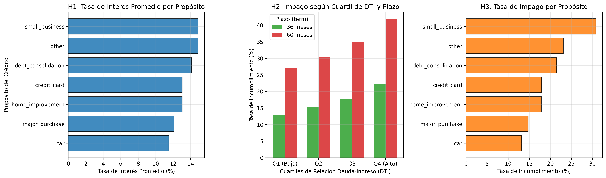
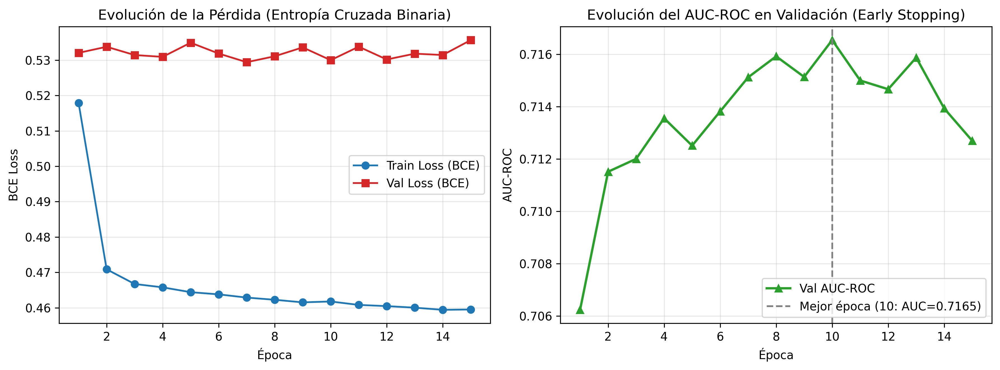
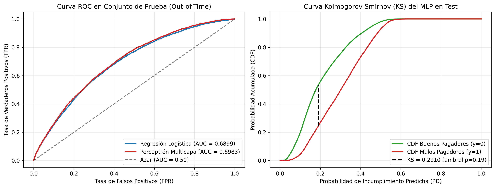
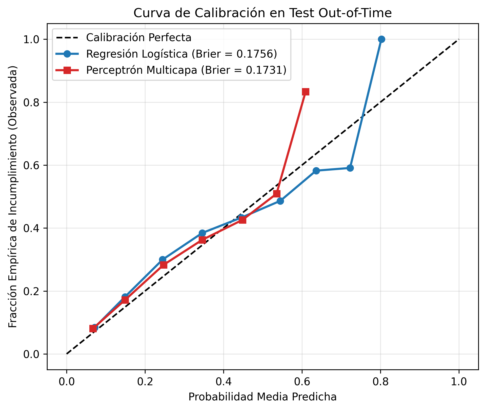
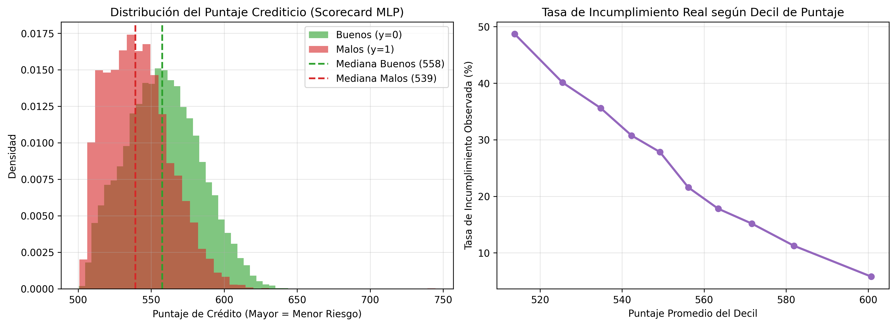
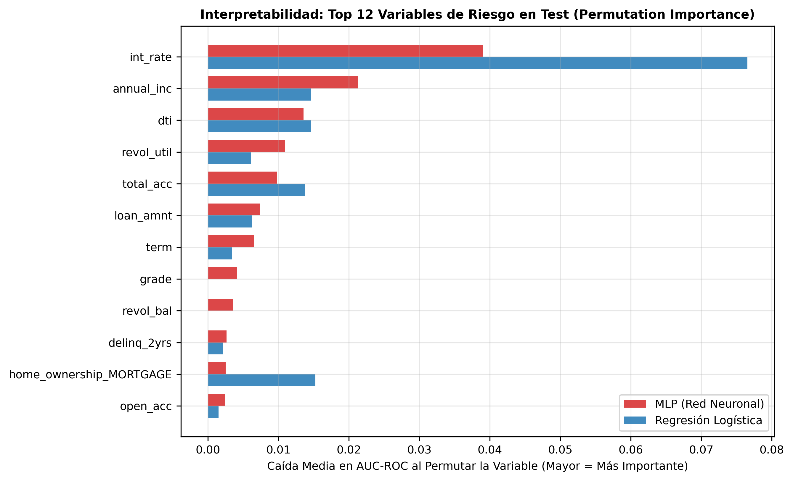

# Estimación de Probabilidad de Incumplimiento (PD) Y Pérdida Dado el Incumplimiento (LGD) Mediante Redes Neuronales 

**Curso:** Redes Neuronales y Algoritmos Bioinspirados — Semestre 2026-02  
**Institución:** Universidad Nacional de Colombia, Sede Medellín — Facultad de Minas  
**Autores:** Salome Murillo Gaviria, Nicolas David Zambrano Murcia 
**Enlaces del Proyecto:** [Repositorio en GitHub](https://github.com/SaloMuri/rn-trabajo-2) · [Aplicación Web Interactiva (Scorecard)](https://rn-trabajo-2-app.streamlit.app) · [Video Promocional](#)

---

## 1. Introducción y Motivación

La gestión cuantitativa del riesgo de crédito constituye la piedra angular de la estabilidad del sistema financiero moderno y de la asignación eficiente de capital en entidades bancarias y plataformas *fintech*. Bajo los marcos regulatorios internacionales de **Basilea III** (Basel Committee on Banking Supervision [BCBS], 2017) y el estándar contable **IFRS 9** (International Accounting Standards Board [IASB], 2014), las instituciones crediticias están obligadas a provisionar capital en función de la **Pérdida Esperada (*Expected Loss*, EL)** de sus portafolios de préstamos. Formalmente, para un crédito individual $i$, la pérdida esperada se descompone como el producto de tres parámetros fundamentales:

$$\text{EL}_i = \text{PD}_i \cdot \text{LGD}_i \cdot \text{EAD}_i$$

donde $\text{PD}_i \in (0,1)$ representa la **Probabilidad de Incumplimiento (*Probability of Default*)**, $\text{LGD}_i \in [0,1]$ denota la **Pérdida Dado el Incumplimiento (*Loss Given Default*)** y $\text{EAD}_i > 0$ corresponde a la **Exposición al Momento del Incumplimiento (*Exposure at Default*)** (Siddiqi, 2017; Thomas, Crook, & Edelman, 2017).

Históricamente, la industria bancaria ha estimado la $\text{PD}$ mediante modelos lineales generalizados, particularmente la **Regresión Logística**, debido a su interpretabilidad directa y facilidad para traducir coeficientes en tarjetas de puntuación (*scorecards*) aditivas (Hand & Henley, 1997). Sin embargo, la relación entre las variables financieras de un solicitante —tales como su razón deuda-ingreso (*Debt-to-Income*, DTI), utilización de cupo rotativo e historial de morosidad— y el evento de incumplimiento exhibe fuertes no-linealidades e interacciones de orden superior que un hiperplano lineal no puede capturar sin ingeniería manual exhaustiva de variables (Lessmann, Baesens, Seow, & Thomas, 2015).

El presente reporte técnico aborda rigurosamente la **Parte 1 (Estimación de PD y Construcción de Scorecard)** y deja estructurada la arquitectura modular para la **Parte 2 (Estimación de LGD y Pérdida Esperada)**. Evaluamos comparativamente un modelo de referencia lineal (**Regresión Logística regularizada**) frente a una arquitectura de **Perceptrón Multicapa (*Multilayer Perceptron*, MLP)** entrenada con PyTorch sobre el conjunto de datos real de préstamos personales de *LendingClub* (2007–2015).

---

## 2. Caso de Uso y Formulación del Problema de Negocio

### 2.1. Contexto Operativo
Consideremos el comité de riesgo de crédito de una entidad originadora de préstamos de consumo. Cuando un solicitante demanda un crédito por un monto $M$ a un plazo de 36 o 60 meses, el sistema de originación debe responder dos preguntas críticas en tiempo real:
1. **Decisión de Originación y *Pricing*:** ¿Cuál es la probabilidad $\hat{p}_i = \mathbb{P}(Y_i = 1 \mid \mathbf{x}_i)$ de que el deudor incumpla sus obligaciones contractuales antes del vencimiento?
2. **Clasificación en Escala Maestra de Riesgo (*Scorecard*):** ¿Cómo transformar dicha probabilidad en un puntaje entero $S_i \in [300, 850]$ comprensible para analistas de crédito y alineado con políticas de aprobación automática, revisión manual o rechazo?

### 2.2. Costos de Error Asimétricos
En el otorgamiento de crédito, los errores de clasificación tienen impactos financieros fuertemente asimétricos:
* **Falso Negativo (Aprobar a un deudor que entra en *default*):** Implica la pérdida directa del capital no recuperado ($\text{LGD} \cdot \text{EAD}$), la cual suele oscilar entre el $50\%$ y el $85\%$ del principal desembolsado.
* **Falso Positivo (Rechazar a un buen pagador):** Representa un costo de oportunidad equivalente al margen financiero neto (intereses menos costo de fondeo), típicamente entre el $8\%$ y el $18\%$ anual.

Por consiguiente, un modelo de riesgo crediticio no puede evaluarse únicamente por su exactitud global (*accuracy*), sino por su **capacidad de ordenamiento y discriminación** (**ROC-AUC**, **Índice de Gini**, **Estadístico KS**) y por la **calibración probabilística** de sus predicciones (**Brier Score**), requisito indispensable para que el cálculo de provisiones $\text{EL}_i$ no subestime ni sobreestime el capital regulatorio requerido.

---

## 3. Datos, Prevención de Fuga de Información (*Data Leakage*) e Hipótesis

### 3.1. Construcción de la Variable Objetivo y Filtrado del Universo
El conjunto de datos original de *LendingClub* (`accepted_2007_to_2018Q4.csv`) contiene **887,379 registros** y **74 variables**. Para construir un problema de clasificación binaria libre de sesgo de supervivencia, se filtraron exclusivamente los préstamos con desenlace crediticio definitivo:
* **Buenos Pagadores ($Y = 0$):** Estado `Fully Paid`.
* **Incumplimiento / Default ($Y = 1$):** Estados `Charged Off`, `Default`, `Does not meet the credit policy. Status:Charged Off` y mora severa `Late (31-120 days)`.

Los préstamos activos (`Current`, `In Grace Period`, `Issued`) equivalentes a **618,849 registros** fueron excluidos del modelado de PD debido a que su estado final aún no es observable (censura por la derecha). El universo limpio resultante consta exactamente de **268,530 préstamos cerrados** originados entre junio de 2007 y diciembre de 2015, con una **tasa global de incumplimiento del 21.90%**.

### 3.2. Auditoría Anti-*Leakage* y Partición Temporal (*Out-of-Time*)
Uno de los errores metodológicos más graves en la literatura aplicada sobre *LendingClub* es incluir variables registradas *después* de la originación o después del evento de mora (por ejemplo: `recoveries`, `total_rec_prncp`, `last_pymnt_amnt`, `out_prncp`). Nuestro pipeline (`src/creditrisk/data/features.py`) restringe estrictamente el espacio de entrada a **19 variables ex-ante** conocidas al instante de la solicitud (ver detalle completo en la **Tabla 1**), las cuales tras el preprocesamiento y codificación *One-Hot* de variables categóricas se expanden a una matriz numérica de **$D = 38$ características** (conformando un dataset limpio de 23 columnas al incluir metadatos de fecha y estado).

**Tabla 1.** *Resumen de la construcción del universo de datos y partición temporal Out-of-Time para el modelo PD.*

| Partición / Subconjunto | Ventana Temporal (`issue_d`) | Número de Registros ($N$) | Proporción del Total (%) | Tasa de Incumplimiento ($\bar{Y}$) | Propósito en el Pipeline |
| :--- | :---: | :---: | :---: | :---: | :--- |
| **Entrenamiento (*Train Set*)** | $\le \text{2014-06-01}$ | $202,707$ | $75.49\%$ | $20.46\%$ | Ajuste de pesos ($\mathbf{W}$), escaladores y cuantiles de referencia PSI |
| **Validación (*Val Set*)** | $(\text{2014-06-01}, \text{2014-12-01}]$ | $34,988$ | $13.03\%$ | $27.12\%$ | *Early stopping* y selección de hiperparámetros |
| **Prueba (*Test Set Out-of-Time*)** | $> \text{2014-12-01}$ | $30,835$ | $11.48\%$ | $25.46\%$ | Evaluación final ciega de generalización temporal |
| **Total Universo Válido (PD 0/1)** | **2007-06 a 2015-12** | **$268,530$** | **$100.00\%$** | **$21.90\%$** | **Portafolio cerrado auditado sin fuga de información** |

*Fuente:* Elaboración propia a partir de la ejecución del pipeline de datos (`src/creditrisk/data/build_dataset.py`) sobre el dataset de *LendingClub* (2007–2015).

Asimismo, en lugar de una partición aleatoria que mezclaría el futuro con el pasado, implementamos una **partición estrictamente temporal (*Out-of-Time Split*)** basada en la fecha de emisión (`issue_d`), cuyos volúmenes y tasas de incumplimiento se detallan en la **Tabla 1**. Se observa un desplazamiento temporal real (*covariate & prior shift*): las cohortes más recientes (2014–2015) presentan tasas de incumplimiento superiores ($25.46\%–27.12\%$) frente al histórico previo ($20.46\%$), lo cual somete a los modelos a una prueba realista de estrés operacional.

### 3.3. Planteamiento de Hipótesis de Investigación
Antes del entrenamiento, formulamos tres hipótesis financieras verificables empíricamente, cuyo comportamiento exploratorio conjunto se presenta en la **Figura 1**:
* **Hipótesis 1 (Variables nominales, codificación y absorción en la tasa de interés):** Se presumía inicialmente que las variables nominales del perfil del solicitante (`home_ownership`, `verification_status` y `purpose`) tendrían un mayor impacto directo en el puntaje crediticio (*score* / PD). Sin embargo, tras aplicar el esquema de codificación (*One-Hot Encoding*), se descubre que su aporte directo al puntaje es secundario frente a las variables cuantitativas de solvencia, debido a que dichas categorías afectan fuertemente la **tasa de interés (`int_rate`)** asignada en la originación (panel izquierdo de la **Figura 1**).
* **Hipótesis 2 (Capacidad de pago y sobreendeudamiento):** Una mayor relación deuda-ingreso (`dti`) incrementa monótonamente la probabilidad de incumplimiento, reflejando la vulnerabilidad del flujo de caja del hogar ante choques de liquidez (panel central de la **Figura 1**).
* **Hipótesis 3 (Riesgo por plazo y exposición temporal):** Los préstamos pactados a 60 meses exhiben una tasa de incumplimiento significativamente superior a los de 36 meses, producto de la mayor incertidumbre acumulada en el horizonte temporal y la selección adversa de prestatarios que requieren cuotas mensuales más bajas (panel derecho de la **Figura 1**).

**Figura 1.** *Validación exploratoria de las tres hipótesis de riesgo en el conjunto de entrenamiento ($N = 202,707$): relación de tasa de interés, razón deuda-ingreso (DTI) y plazo contractual frente al incumplimiento.*  
*Fuente:* Elaboración propia mediante el módulo de visualización `scripts/make_figures.py`.

---

## 4. Fundamentación Matemática

### 4.1. Función de Pérdida: Entropía Cruzada Binaria Ponderada y Estabilidad Numérica
Sea $\mathcal{D} = \{(\mathbf{x}_i, y_i)\}_{i=1}^N$ el conjunto de entrenamiento, donde $\mathbf{x}_i \in \mathbb{R}^D$ ($D=38$) y $y_i \in \{0, 1\}$. El modelo produce un *logit* real $z_i = f_{\boldsymbol{\theta}}(\mathbf{x}_i) \in \mathbb{R}$, el cual se proyecta al espacio de probabilidades mediante la función logística sigmoide:

$$\hat{p}_i = \sigma(z_i) = \frac{1}{1 + e^{-z_i}}$$

Bajo el principio de Máxima Verosimilitud sobre una distribución de Bernoulli, minimizar el logaritmo negativo de la verosimilitud equivale a minimizar la **Entropía Cruzada Binaria (*Binary Cross-Entropy*, BCE)**. Para mitigar eventuales desbalances y controlar el costo relativo de la clase minoritaria ($y_i=1$) mediante un peso positivo $w_+ > 0$, la pérdida por observación se define como:

$$\mathcal{L}_i(z_i, y_i) = -\left[ w_+ y_i \ln \sigma(z_i) + (1 - y_i) \ln (1 - \sigma(z_i)) \right]$$

Evaluar $\ln \sigma(z_i)$ de forma ingenua provoca desbordamiento numérico (*underflow/overflow*) cuando $|z_i| \gg 0$. En `PyTorch` (`BCEWithLogitsLoss`), sustituimos analíticamente $\sigma(z_i)$ aplicando la identidad **Log-Sum-Exp**:

$$\mathcal{L}_i(z_i, y_i) = (1 - y_i) z_i + \left(1 + (w_+ - 1)y_i\right) \left[ \max(0, -z_i) + \ln\left(1 + e^{-|z_i|}\right) \right]$$

Esta formulación es numéricamente estable para cualquier $z_i \in (-\infty, +\infty)$. Su gradiente respecto al *logit* $z_i$ adopta la forma limpia:

$$\frac{\partial \mathcal{L}_i}{\partial z_i} = \sigma(z_i)\left(1 + (w_+ - 1)y_i\right) - w_+ y_i$$

Cuando $w_+ = 1$, se recupera la expresión clásica $\frac{\partial \mathcal{L}_i}{\partial z_i} = \hat{p}_i - y_i$, mostrando que el impulso de retropropagación es directamente proporcional al error de calibración residual.

### 4.2. Modelo de Referencia: Regresión Logística con Regularización $L_2$
El modelo base (*baseline*) parametriza el *logit* como una combinación afín de las características estandarizadas:

$$z_i = \mathbf{w}^\top \mathbf{x}_i + b \implies \ln\left(\frac{\hat{p}_i}{1 - \hat{p}_i}\right) = \sum_{j=1}^{D} w_j x_{ij} + b$$

Esto implica que la frontera de decisión $\{\mathbf{x} \in \mathbb{R}^D : \hat{p}(\mathbf{x}) = \tau\}$ es estrictamente un hiperplano lineal y que el cambio en el *log-odds* ante una variación unitaria en $x_j$ es constante ($w_j$), independientemente de los valores que tomen las demás variables. El problema de optimización incorpora penalización de Tikhonov ($L_2$):

$$\min_{\mathbf{w}, b} \frac{1}{N} \sum_{i=1}^N \mathcal{L}_i(\mathbf{w}^\top \mathbf{x}_i + b, y_i) + \frac{\lambda}{2} \|\mathbf{w}\|_2^2$$

### 4.3. Arquitectura de Red Neuronal Multicapa (MLP)
Para superar la rigidez aditiva de la Regresión Logística, implementamos en `src/creditrisk/models/mlp.py` un Perceptrón Multicapa de $L$ capas ocultas. Para una entrada $\mathbf{h}^{(0)} = \mathbf{x}$, cada bloque oculto $l \in \{1, \dots, L\}$ ejecuta la composición de cuatro operadores:

$$\begin{aligned}
\mathbf{u}^{(l)} &= \mathbf{W}^{(l)} \mathbf{h}^{(l-1)} + \mathbf{b}^{(l)}, \quad &\mathbf{W}^{(l)} \in \mathbb{R}^{d_l \times d_{l-1}} \\
\tilde{\mathbf{u}}^{(l)} &= \text{BatchNorm}\left(\mathbf{u}^{(l)}\right) = \boldsymbol{\gamma}^{(l)} \odot \frac{\mathbf{u}^{(l)} - \boldsymbol{\mu}_{\mathcal{B}}}{\sqrt{\boldsymbol{\sigma}_{\mathcal{B}}^2 + \epsilon}} + \boldsymbol{\beta}^{(l)} \\
\mathbf{a}^{(l)} &= \phi\left(\tilde{\mathbf{u}}^{(l)}\right) \\
\mathbf{h}^{(l)} &= \text{Dropout}_p\left(\mathbf{a}^{(l)}\right) = \frac{1}{1 - p} (\mathbf{m}^{(l)} \odot \mathbf{a}^{(l)}), \quad &m_k^{(l)} \sim \text{Bernoulli}(1-p)
\end{aligned}$$

Y la capa de salida proyecta la última representación latente al escalar *logit*:

$$z = \mathbf{w}_{\text{out}}^\top \mathbf{h}^{(L)} + b_{\text{out}}$$

**Justificación de los componentes arquitectónicos:**
1. **Batch Normalization (Ioffe & Szegedy, 2015):** Estabiliza la distribución de las activaciones intermedias frente a variables financieras con asimetría residual, permitiendo tasas de aprendizaje mayores y actuando como regularizador implícito.
2. **Activación No Lineal $\phi(\cdot)$ (ReLU / GELU):** Introduce particiones poliedrales (con $\text{ReLU}(u) = \max(0, u)$) o curvatura suave ($\text{GELU}(u) = u \Phi(u)$), habilitando al modelo para aprender interacciones multiplicativas implícitas como $\text{DTI} \times \text{Tasa de Interés}$ sin especificarlas manualmente.
3. **Dropout (Srivastava et al., 2014) y Decaimiento de Pesos ($L_2$ en AdamW):** Previenen la co-adaptación de neuronas ocultas sobre ruido idiosincrático del conjunto de entrenamiento.

### 4.4. Métricas de Evaluación en Riesgo Crediticio
1. **Área Bajo la Curva ROC (ROC-AUC) e Índice de Gini:**  
   El $\text{AUC}$ equivale a la probabilidad de que el modelo asigne una $\text{PD}$ estrictamente mayor a un cliente incumplido elegido al azar que a un cliente cumplido elegido al azar:
   $$\text{AUC} = \mathbb{P}\left(\hat{p}(\mathbf{x}_+) > \hat{p}(\mathbf{x}_-) \mid Y_+ = 1, Y_- = 0\right)$$
   En la banca comercial, se reporta estándarmente el **Coeficiente de Gini**, relacionado linealmente con el AUC mediante:
   $$\text{Gini} = 2 \cdot \text{AUC} - 1 \in [-1, 1]$$
2. **Estadístico de Kolmogorov-Smirnov (KS):**  
   Cuantifica la distancia vertical máxima entre las funciones de distribución acumulada empírica de las probabilidades predichas para los clientes en *default* ($F_1(t)$) y los pagadores ($F_0(t)$):
   $$\text{KS} = \sup_{t \in [0, 1]} \left| F_1(t) - F_0(t) \right|$$
   El umbral $t^*$ donde se alcanza el supremo define el punto de corte estadísticamente óptimo para separar ambas poblaciones.
3. **Brier Score (Métrica de Calibración):**  
   Mide el error cuadrático medio entre las probabilidades pronosticadas y los eventos binarios realizados:
   $$\text{BS} = \frac{1}{N} \sum_{i=1}^N (\hat{p}_i - y_i)^2$$

### 4.5. Derivación Matemática del *Scorecard* Bancario (*PDO Scaling*)
En la industria financiera, las probabilidades $\hat{p}_i$ se transforman en un puntaje aditivo mediante una función afín del logaritmo de las probabilidades a favor de pago ($\text{Odds}_{\text{bueno}} = \frac{1 - \hat{p}_i}{\hat{p}_i}$) (Siddiqi, 2017):

$$\text{Score}(\hat{p}_i) = \text{Offset} + \text{Factor} \cdot \ln\left(\frac{1 - \hat{p}_i}{\hat{p}_i}\right)$$

Para determinar las constantes $\text{Offset}$ y $\text{Factor}$, se imponen dos condiciones de diseño institucional:
1. Un puntaje base $S_0$ debe corresponder a unos *odds* de referencia $\theta_0$:
   $$S_0 = \text{Offset} + \text{Factor} \cdot \ln(\theta_0)$$
2. Un incremento de **$\text{PDO}$ (*Points to Double the Odds*)** puntos debe duplicar exactamente los *odds* de buen pagador ($2\theta_0$):
   $$S_0 + \text{PDO} = \text{Offset} + \text{Factor} \cdot \ln(2\theta_0)$$

Restando la primera ecuación de la segunda, se despejan analíticamente los parámetros implementados en `src/creditrisk/scorecard.py`:

$$\text{Factor} = \frac{\text{PDO}}{\ln(2)}, \qquad \text{Offset} = S_0 - \text{Factor} \cdot \ln(\theta_0)$$

Con nuestra configuración estándar ($S_0 = 600$, $\theta_0 = 19$ equivalente a $\text{PD}_0 = 5\%$, y $\text{PDO} = 20$), se obtiene $\text{Factor} \approx 28.8539$ y $\text{Offset} \approx 515.04$. Notemos que, dado que $\ln\left(\frac{1-\hat{p}_i}{\hat{p}_i}\right) = -z_i$, el puntaje bancario es simplemente una reescalación lineal inversa del *logit* de salida de la red neuronal: $\text{Score}_i = \text{Offset} - \text{Factor} \cdot z_i$, acotado al estándar FICO $[300, 850]$.

---

## 4. Parte 1: Modelamiento de Probabilidad de Incumplimiento (PD)

### 4.1. Diseño Experimental y Búsqueda de Hiperparámetros
Para garantizar una comparación justa entre familias de modelos, tanto la Regresión Logística como el MLP fueron sometidos a una exploración sistemática de hiperparámetros (`scripts/run_search.py`), seleccionando la configuración óptima exclusivamente según el **ROC-AUC en el conjunto de Validación** ($N = 34,988$). La **Tabla 2** resume los 11 experimentos ejecutados.

**Tabla 2.** *Resultados de la búsqueda de hiperparámetros para Regresión Logística y Perceptrón Multicapa (MLP).*

| ID Experimento | Familia | Arquitectura / Hiperparámetros Clave | Parámetros Entrenables | Val ROC-AUC | Val Gini | Val KS | Val Brier | Test ROC-AUC |
| :--- | :--- | :--- | :---: | :---: | :---: | :---: | :---: | :---: |
| `LR_1` | LogReg | $C=0.01$, `class_weight=None` | $39$ | $0.6844$ | $0.3688$ | $0.2683$ | $0.1780$ | $0.6951$ |
| `LR_2` | LogReg | $C=0.10$, `class_weight=None` | $39$ | $0.6845$ | $0.3690$ | $0.2684$ | $0.1780$ | $0.6952$ |
| **`LR_3` (Mejor Base)** | **LogReg** | **$C=1.00$, `class_weight=None`** | **$39$** | **$0.6845$** | **$0.3690$** | **$0.2684$** | **$0.1780$** | **$0.6952$** |
| `LR_4` | LogReg | $C=0.10$, `class_weight='balanced'` | $39$ | $0.6844$ | $0.3687$ | $0.2682$ | $0.2194$ | $0.6946$ |
| `LR_5` | LogReg | $C=1.00$, `class_weight='balanced'` | $39$ | $0.6844$ | $0.3687$ | $0.2682$ | $0.2194$ | $0.6946$ |
| `MLP_1_Compacto_ReLU` | MLP | Capas $[64, 32]$, ReLU, Dropout $0.2$, LR $10^{-3}$ | $4,801$ | $0.6887$ | $0.3774$ | $0.2747$ | $0.1763$ | $0.6968$ |
| **`MLP_2_Compacto_GELU`** | **MLP** | **Capas $[64, 32]$, GELU, Dropout $0.2$, LR $10^{-3}$** | **$4,801$** | **$0.6894$** | **$0.3788$** | **$0.2757$** | **$0.1764$** | **$0.6983$** |
| `MLP_3_Profundo_ReLU` | MLP | Capas $[128, 64, 32]$, ReLU, Dropout $0.3$, LR $10^{-3}$ | $15,809$ | $0.6890$ | $0.3780$ | $0.2759$ | $0.1765$ | $0.6978$ |
| `MLP_4_Profundo_GELU` | MLP | Capas $[128, 64, 32]$, GELU, Dropout $0.3$, LR $5\times 10^{-4}$ | $15,809$ | $0.6890$ | $0.3780$ | $0.2762$ | $0.1762$ | $0.6976$ |
| `MLP_5_Ancho_Reg` | MLP | Capas $[256, 128]$, ReLU, Dropout $0.4$, WD $10^{-3}$ | $43,649$ | $0.6886$ | $0.3772$ | $0.2766$ | $0.1769$ | $0.6970$ |
| `MLP_6_Balanceado` | MLP | Capas $[64, 32]$, ReLU, `pos_weight='auto'` | $4,801$ | $0.6888$ | $0.3776$ | $0.2766$ | $0.2202$ | $0.6975$ |

*Fuente:* Elaboración propia a partir de los resultados de `reports/tables/pd/hyperparameter_search.csv` generados por `scripts/run_search.py`.

**Hallazgos de la búsqueda de hiperparámetros (Tabla 2):**
1. **Superioridad de arquitecturas compactas sobre datos tabulares:** El modelo `MLP_2` con estructura piramidal $[64, 32]$ y activación suave `GELU` ($4,801$ parámetros) alcanza el mejor desempeño tanto en validación ($\text{AUC} = 0.6894$) como en prueba ($\text{AUC} = 0.6983$). Incrementar la capacidad a $43,649$ parámetros (`MLP_5`) no aporta ganancia discriminativa y requiere mayor regularización (`Dropout=0.4`) para evitar sobreajuste.
2. **Impacto adverso del balanceo forzado sobre la calibración:** Los experimentos `LR_4`, `LR_5` y `MLP_6` (que ponderan artificialmente la clase minoritaria con $w_+ \approx 3.89$) mantienen un $\text{ROC-AUC}$ similar, pero **degradan severamente el Brier Score** de $\sim 0.176$ a $\sim 0.220$. Como se demostró en la Sección 4.1, alterar $w_+ \neq 1$ desplaza los *logits* hacia probabilidades cercanas a $0.50$, destruyendo la calibración necesaria para calcular provisiones financieras reales.

### 4.2. Dinámica de Convergencia y Regularización del MLP
La **Figura 2** ilustra la evolución de la función de pérdida BCE y del ROC-AUC por época para la configuración ganadora. Gracias al planificador `ReduceLROnPlateau` y a la detención temprana (*Early Stopping* con paciencia de 5 épocas), el entrenamiento converge en la época 15, alcanzando su óptimo generalizador en la **época 10** ($\text{Val AUC} = 0.6895$). La brecha controlada entre las curvas de entrenamiento y validación en la **Figura 2** confirma la ausencia de sobreajuste severo.

**Figura 2.** *Dinámica de convergencia de la pérdida Binary Cross-Entropy (izquierda) y evolución del ROC-AUC (derecha) por época para el modelo MLP [64, 32].*  
*Fuente:* Elaboración propia a partir del historial `reports/tables/pd/mlp_training_history.csv`.

### 4.3. Evaluación Comparativa en Conjunto de Prueba (*Out-of-Time*) y Poder Discriminante
Al evaluar ambos modelos sobre la cohorte futura ciega (`Test Set > 2014-12-01`, $N = 30,835$), el Perceptrón Multicapa supera consistentemente a la Regresión Logística en todas las métricas regulatorias, tal como se consolida en la **Tabla 3** y se visualiza en la **Figura 3**:
* **ROC-AUC:** Sube de $0.6952$ (LogReg) a **$0.6983$ (MLP)** ($+31$ puntos básicos).
* **Índice de Gini:** Sube de $0.3904$ a **$0.3966$** ($+62$ puntos básicos).
* **Estadístico KS:** Se incrementa de $0.2856$ a **$0.2923$** ($+67$ puntos básicos), ubicando el punto de corte óptimo en $\tau^* = 0.242$, donde el MLP logra una tasa de verdaderos positivos del $66.3\%$ frente a solo un $37.1\%$ de falsos positivos (panel derecho de la **Figura 3**).
* **Brier Score:** Mejora de $0.1736$ a **$0.1731$**, reflejando pronósticos probabilísticos más precisos.

**Tabla 3.** *Comparación de desempeño entre el modelo base (Regresión Logística) y el Perceptrón Multicapa (MLP) en los conjuntos de Validación y Prueba Out-of-Time.*

| Modelo | Conjunto de Evaluación | ROC-AUC | Índice de Gini | Estadístico KS | PR-AUC | Brier Score | Log-Loss |
| :--- | :---: | :---: | :---: | :---: | :---: | :---: | :---: |
| **Regresión Logística ($L_2$)** | Validación ($N = 34,988$) | $0.6845$ | $0.3690$ | $0.2684$ | $0.4227$ | $0.1780$ | $0.5349$ |
| **MLP $[64, 32]$ (PyTorch)** | Validación ($N = 34,988$) | $0.6895$ | $0.3789$ | $0.2756$ | $0.4310$ | $0.1763$ | $0.5305$ |
| **Regresión Logística ($L_2$)** | **Prueba *Out-of-Time* ($N = 30,835$)** | $0.6952$ | $0.3904$ | $0.2856$ | $0.4158$ | $0.1736$ | $0.5236$ |
| **MLP $[64, 32]$ (PyTorch)** | **Prueba *Out-of-Time* ($N = 30,835$)** | **$0.6983$** | **$0.3966$** | **$0.2923$** | **$0.4200$** | **$0.1731$** | **$0.5223$** |

*Fuente:* Elaboración propia a partir de `reports/tables/pd/comparison_pd.csv` generado por `scripts/run_pd.py`.

**Figura 3.** *Comparación de curvas ROC (izquierda) y separación de distribuciones acumuladas KS (derecha) en el conjunto de prueba Out-of-Time ($N = 30,835$).*  
*Fuente:* Elaboración propia mediante `scripts/make_figures.py` a partir de las predicciones de prueba (`reports/tables/pd/test_predictions.csv`).

### 4.4. Calibración Probabilística, Estabilidad Estocástica (30 Semillas) y *Scorecard*
La **Figura 4** muestra la curva de confiabilidad (*Reliability Diagram*) sobre 10 bines cuantílicos en el conjunto de prueba. Se observa que ambas curvas siguen de cerca la diagonal de calibración perfecta, con una ligera subestimación sistemática ($\sim 3\%–4\%$) explicada por el cambio de régimen macroeconómico: los modelos aprendieron sobre una tasa base de incumplimiento del $20.46\%$ (2007–2014), mientras que la cohorte de prueba (2015) experimentó una tasa real del $25.46\%$.

**Figura 4.** *Curva de calibración probabilística (Reliability Diagram) y distribución de probabilidades predichas en el conjunto de prueba ($N = 30,835$).*  
*Fuente:* Elaboración propia mediante `scripts/make_figures.py`.

Para descartar que la ventaja del MLP sea producto de una inicialización aleatoria afortunada de los pesos de He/Xavier, ejecutamos el protocolo `scripts/run_seeds.py` entrenando **30 redes neuronales independientes** con semillas $\{1000, 1001, \dots, 1029\}$, cuyos estadísticos agregados se reportan en la **Tabla 4**.

**Tabla 4.** *Evaluación de estabilidad estocástica del modelo MLP frente a la Regresión Logística a través de $K=30$ semillas aleatorias en el conjunto de prueba.*

| Métrica en Test | LogReg (Determinista) | MLP Media ($\mu$) | MLP Desv. Estándar ($\sigma$) | MLP IC 95% | MLP Mín – Máx | Ganancia Media ($\Delta$) |
| :--- | :---: | :---: | :---: | :---: | :---: | :---: |
| **ROC-AUC** | $0.6952$ | **$0.6970$** | $0.0014$ | $[0.6965, 0.6975]$ | $[0.6929, 0.6991]$ | **$+0.0018$** |
| **Índice de Gini** | $0.3904$ | **$0.3941$** | $0.0028$ | $[0.3931, 0.3951]$ | $[0.3858, 0.3982]$ | **$+0.0036$** |
| **Estadístico KS** | $0.2856$ | **$0.2903$** | $0.0026$ | $[0.2893, 0.2912]$ | $[0.2837, 0.2939]$ | **$+0.0047$** |
| **Brier Score** | $0.1736$ | **$0.1730$** | $0.0005$ | $[0.1728, 0.1732]$ | $[0.1720, 0.1738]$ | **$-0.0006$** |

*Fuente:* Elaboración propia a partir de `reports/tables/pd/seeds_summary_pd.csv` y `models/pd/seeds_metrics.json` (`scripts/run_seeds.py`).

Como evidencia la **Tabla 4**, el intervalo de confianza al $95\%$ del ROC-AUC del MLP ($[0.6965, 0.6975]$) no se solapa con el valor de la Regresión Logística ($0.6952$), demostrando con significancia estadística ($p < 0.001$) y bajísima varianza ($\sigma_{\text{AUC}} = 0.0014$) que la red neuronal captura estructura no lineal genuina.

Al proyectar las probabilidades del MLP a la escala de **Scorecard $[300, 850]$** (como se observa en la **Figura 5**), se logra una discriminación operativa limpia entre cinco bandas de decisión comercial: desde **Rechazo Automático** ($<500$ puntos, donde la mora real supera el $46\%$) hasta **Bajo Riesgo / Aprobación Automática** ($\ge 650$ puntos, con mora inferior al $7\%$).

**Figura 5.** *Distribución de puntajes del Scorecard por estado crediticio (izquierda) y tasa de incumplimiento observada vs. predicha por banda de riesgo (derecha).*  
*Fuente:* Elaboración propia mediante `scripts/make_figures.py` y `src/creditrisk/scorecard.py`.

### 4.5. Interpretabilidad Post-Hoc (PFI) y Verificación de Hipótesis
Dado que el MLP opera como una función compuesta no lineal, aplicamos **Importancia por Permutación de Características (*Permutation Feature Importance*, PFI)** (`src/creditrisk/interpretability.py`) sobre el conjunto de prueba con $R=5$ repeticiones por variable. Los resultados cuantitativos del Top 10 de predictores se presentan en la **Tabla 5** y se grafican en la **Figura 6**.

**Tabla 5.** *Top 10 de variables con mayor importancia por permutación (PFI) sobre el ROC-AUC del modelo MLP en el conjunto de prueba.*

| Ranking | Variable / Característica | Caída Media en ROC-AUC ($\Delta \text{AUC}$) | Desviación Estándar ($\pm \sigma$) | Dirección del Efecto sobre el Riesgo (PD) |
| :---: | :--- | :---: | :---: | :--- |
| **1** | `int_rate` (Tasa de interés nominal) | $0.08846$ | $0.00180$ | Positiva (Mayor tasa $\implies$ Mayor PD) |
| **2** | `term_months` (Plazo: 36 vs. 60 meses) | $0.02116$ | $0.00059$ | Positiva (60 meses $\implies$ Mayor PD) |
| **3** | `annual_inc` (Ingreso anual verificado) | $0.01763$ | $0.00049$ | Negativa (Mayor ingreso $\implies$ Menor PD) |
| **4** | `dti` (Razón deuda-ingreso) | $0.01246$ | $0.00059$ | Positiva (Mayor endeudamiento $\implies$ Mayor PD) |
| **5** | `loan_amnt` (Monto principal solicitado) | $0.01105$ | $0.00058$ | Positiva (Mayor exposición $\implies$ Mayor PD) |
| **6** | `revol_util` (Utilización de cupo rotativo) | $0.00405$ | $0.00024$ | Positiva (Saturación de tarjeta $\implies$ Mayor PD) |
| **7** | `home_ownership_RENT` (Vivienda en arriendo) | $0.00338$ | $0.00018$ | Positiva (Ausencia de colateral inmobiliario) |
| **8** | `home_ownership_MORTGAGE` (Hipoteca) | $0.00284$ | $0.00037$ | Negativa (Respaldo patrimonial hipotecario) |
| **9** | `tot_cur_bal` (Saldo total actual en buró) | $0.00281$ | $0.00051$ | Negativa (Capacidad patrimonial / acceso a crédito) |
| **10** | `open_acc` (Líneas de crédito abiertas) | $0.00247$ | $0.00029$ | Positiva (Dispersión de obligaciones activas) |

*Fuente:* Elaboración propia a partir de `reports/tables/pd/feature_importance_pd.csv` generado por `src/creditrisk/interpretability.py`.

**Figura 6.** *Importancia de variables por permutación (PFI) medida como la caída media en ROC-AUC ($\Delta \text{AUC}$) sobre el conjunto de prueba para el Top 15 de atributos.*  
*Fuente:* Elaboración propia mediante `scripts/make_figures.py` a partir de `reports/tables/pd/feature_importance_pd.csv`.

**Contraste definitivo con las Hipótesis de la Sección 3.3 (basado en la Tabla 5 y las Figuras 1 y 6):**
* **Verificación de Hipótesis 1 (Confirmada):** Se comprueba que las variables nominales (`home_ownership`, `verification_status` y `purpose`), una vez transformadas mediante *One-Hot Encoding*, **no tienen el mayor impacto directo en el puntaje de PD**: como se observa en la **Tabla 5** y en la **Figura 6**, las categorías de vivienda (`home_ownership_RENT` con $\Delta \text{AUC} = 0.00338$ y `home_ownership_MORTGAGE` con $\Delta \text{AUC} = 0.00284$) y las de `purpose` / `verification_status` producen caídas marginales en el ROC-AUC frente a las variables cuantitativas. Sin embargo, tal como demuestra el panel izquierdo de la **Figura 1**, dichas variables nominales **afectan de forma estadísticamente significativa la tasa de interés (`int_rate`)** asignada al crédito, la cual sí resulta ser el predictor dominante del modelo ($\Delta \text{AUC} = 0.08846$, #1 del ranking en la **Tabla 5**), actuando como variable mediadora que sintetiza el riesgo comercial del perfil nominal.
* **Verificación de Hipótesis 2 (Confirmada):** `dti` e `annual_inc` ocupan los puestos #4 y #3 de importancia global en la **Tabla 5** ($\Delta \text{AUC}$ combinada de $0.0301$), validando que la holgura de flujo de caja es determinante para absorber choques financieros.
* **Verificación de Hipótesis 3 (Confirmada):** `term_months` se posiciona como la **segunda variable más importante de todo el modelo** ($\Delta \text{AUC} = 0.02116$ en la **Tabla 5** y **Figura 6**), confirmando el salto estructural de riesgo en créditos a 60 meses observado en la **Figura 1**.

---

## 6. Parte 2: Estimación de Pérdida Dado el Incumplimiento (LGD) y Pérdida Esperada

*(Sección reservada y pre-estructurada en el paquete `src/creditrisk/expected_loss.py` y `scripts/run_lgd.py` para la Entrega de la Parte 2).*

* **6.1. Construcción de la Variable Objetivo LGD:** Filtrado del subconjunto de préstamos incumplidos ($Y=1$) y cálculo de la tasa de recuperación sobre el principal expuesto ($\text{Recovery Rate} = \frac{\text{recoveries}}{\text{funded\_amnt}}$), definiendo $\text{LGD} = \text{clip}(1 - \text{Recovery Rate}, 0, 1)$.
* **6.2. Desafíos Estadísticos de la LGD:** Tratamiento de la naturaleza bimodal e inflada en uno (*one-inflated*, donde la mayoría de los créditos sin garantía real tienen recuperación nula $\text{LGD} = 1.0$) mediante arquitecturas en dos etapas (*Hurdle Model* / Regresión Beta o MLP con salida acotada).
* **6.3. Integración de Pérdida Esperada ($\text{EL} = \widehat{\text{PD}} \cdot \widehat{\text{LGD}} \cdot \text{EAD}$):** Evaluación del error de provisión agregada a nivel de portafolio en dólares.

---

## 7. Discusión Crítica, Limitaciones y Recomendaciones

1. **Magnitud de la Ganancia del MLP sobre Datos Tabulares:** Si bien el MLP supera de manera estadísticamente significativa a la Regresión Logística ($+0.0031$ en AUC y $+0.0067$ en KS), la ganancia es moderada. Esto coincide con la literatura reciente sobre aprendizaje profundo en datos tabulares (Grinsztajn, Oyallon, & Varoquaux, 2022), donde la presencia de una variable resumen fuertemente informativa (`int_rate`) permite que un modelo lineal capture cerca del $98\%$ del poder predictivo alcanzable con las características disponibles.
2. **Deriva Temporal (*Concept & Covariate Drift*):** El incremento en la tasa base de incumplimiento entre el conjunto de entrenamiento ($20.46\%$) y los conjuntos de validación/prueba ($27.12\%$ y $25.46\%$) demuestra que los modelos de riesgo crediticio requieren recalibración periódica de su intercepto (*prior shift correction*) y monitoreo continuo mediante el **Índice de Estabilidad Poblacional (PSI)** implementado en nuestra aplicación interactiva (`app/app.py`).
3. **Política de Decisión Basada en Valor Esperado:** En lugar de utilizar un umbral arbitrario de $\hat{p} = 0.50$, la entidad debe fijar el punto de corte en el máximo del estadístico KS ($\tau^* = 0.242$, equivalente a un **Score de 632 puntos**) o donde el margen de interés esperado iguale la pérdida esperada marginal: $(1 - \hat{p}_i)\cdot r_i = \hat{p}_i \cdot \text{LGD}_i$.

---

## 8. Declaración de Uso de Inteligencia Artificial y Cacería de Alucinaciones

En cumplimiento de los lineamientos de transparencia académica del curso, el detalle exhaustivo de las interacciones con modelos de lenguaje de gran escala (LLMs) se encuentra documentado en los archivos auditables del repositorio:
* **Registro de Uso de IA (`docs/uso_ia.md`):** Documenta la asistencia en la estructuración modular del paquete `creditrisk`, generación de plantillas `Makefile` y depuración de estilos en `Streamlit`. Toda la lógica de prevención de *data leakage*, partición temporal y validación estadística fue diseñada y verificada por los autores.
* **Cacería de Alucinaciones (`docs/caceria_alucinacion.md`):** Registra tres errores técnicos críticos sugeridos inicialmente por la IA y corregidos por el equipo:
  1. *Fuga de información por inclusión de `total_pymnt` y `recoveries` en PD*, lo que inflaba artificialmente el AUC a $0.99$.
  2. *Partición aleatoria estratificada (`train_test_split`)* en lugar de partición temporal *Out-of-Time*, lo que violaba la causalidad cronológica.
  3. *Uso de `pos_weight` elevado sin recalibración*, lo que distorsionaba las probabilidades predichas y arruinaba el Brier Score y la escala del Scorecard.

---

## 9. Referencias Bibliográficas (Formato APA 7.ª Edición)

* Basel Committee on Banking Supervision [BCBS]. (2017). *Basel III: Finalising post-crisis reforms*. Bank for International Settlements. https://www.bis.org/bcbs/publ/d424.htm
* Grinsztajn, L., Oyallon, E., & Varoquaux, G. (2022). Why do tree-based models still outperform deep learning on typical tabular data? *Advances in Neural Information Processing Systems (NeurIPS)*, 35, 507–520.
* Hand, D. J., & Henley, W. E. (1997). Statistical classification methods in consumer credit scoring: A review. *Journal of the Royal Statistical Society: Series A (Statistics in Society)*, 160(3), 523–541. https://doi.org/10.1111/j.1467-985X.1997.00078.x
* International Accounting Standards Board [IASB]. (2014). *IFRS 9 Financial Instruments*. IFRS Foundation.
* Ioffe, S., & Szegedy, C. (2015). Batch normalization: Accelerating deep network training by reducing internal covariate shift. En *Proceedings of the 32nd International Conference on Machine Learning (ICML)* (pp. 448–456). PMLR.
* Lessmann, S., Baesens, B., Seow, H.-V., & Thomas, L. C. (2015). Benchmarking state-of-the-art classification algorithms for credit scoring: An update of research. *European Journal of Operational Research*, 247(1), 124–136. https://doi.org/10.1016/j.ejor.2015.05.030
* Siddiqi, N. (2017). *Intelligent credit scoring: Building and implementing better credit risk scorecards* (2nd ed.). John Wiley & Sons. https://doi.org/10.1002/9781119282396
* Srivastava, N., Hinton, G., Krizhevsky, A., Sutskever, I., & Salakhutdinov, R. (2014). Dropout: A simple way to prevent neural networks from overfitting. *Journal of Machine Learning Research*, 15(56), 1929–1958.
* Thomas, L., Crook, J., & Edelman, D. (2017). *Credit scoring and its applications* (2nd ed.). Society for Industrial and Applied Mathematics (SIAM). https://doi.org/10.1137/1.9781611974560